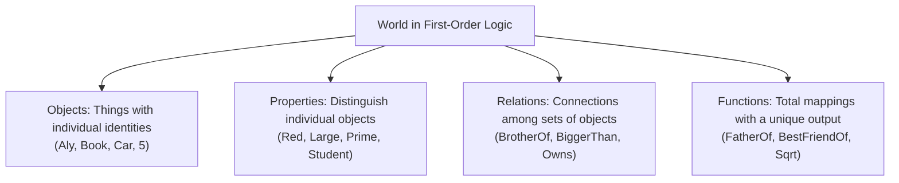
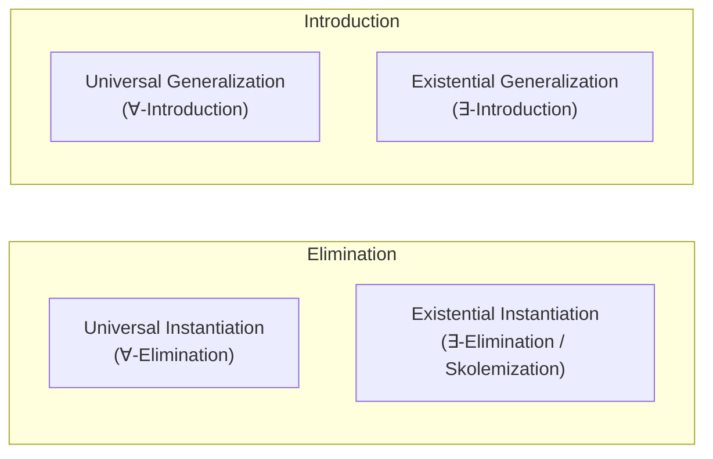

# Lecture: Propositional and First-Order Logic

### Lecture Agenda
1. [**Introduction & The Big Ideas**](#1-introduction--the-big-ideas): Role of logic in AI, knowledge-based agents, and KR formalisms.
2. [**Propositional Logic (PL)**](#2-propositional-logic-pl): Syntax, connectives, truth tables, model checking, entailment, and limitations.
3. [**First-Order Logic (FOL) Foundations**](#3-first-order-logic-fol): Ontological commitments (objects, relations, functions), terms, and BNF grammar.
4. [**Quantifiers & Scoping**](#4-quantifiers): Universal ($\forall$) and existential ($\exists$) quantification, scope, order sensitivity, and De Morgan's laws.
5. [**Quantified Inference Rules**](#5-quantified-inference-rules): Universal/Existential Instantiation (Skolemization) and Generalization.
6. [**Translating Natural Language to FOL**](#6-translating-natural-language-english-to-first-order-logic): Translating complex English sentences and expressing exact numerical cardinality.
7. [**Genealogy Knowledge Base Case Study**](#7-case-study-genealogy-knowledge-base-in-fol): Axiomatic family tree relations, recursion, and query evaluation under CWA.
8. [**Comparison: PL vs. FOL**](#8-propositional-logic-vs-first-order-logic): Systematic comparison of expressiveness, complexity, and decidability.
9. [**Key Takeaways**](#9-key-takeaways): Summary of fundamental principles and practical AI trade-offs.

---

---

## 1. Introduction & The Big Ideas

Logic provides a formal, mathematically rigorous foundation for **Knowledge Representation (KR)** and **Reasoning** in Artificial Intelligence.

```
+-------------------------------------------------------------------------+
|                        KNOWLEDGE-BASED AGENT                            |
|                                                                         |
|    Sensors ---> [ Inference Engine ] <---> [ Knowledge Base (KB) ]     |
|                        |                  (Sentences in Logic)          |
|                        v                                                |
|   Actuators <-- [ Selected Action ]                                     |
+-------------------------------------------------------------------------+
```

### Core Insights
* **Logic as KR Language:** Expresses knowledge declaratively, allowing general-purpose inference algorithms to derive new facts.
* **Propositional Logic (PL):** A simple, boolean-based foundation with decidable inference, but limited in expressive power.
* **First-Order Logic (FOL):** Models the world in terms of objects, relations, and functions with quantifiers; significantly more expressive and widely used in AI.
* **Logic Variations:** Horn logic, Description Logics (e.g., OWL), Higher-Order Logic, Multi-Valued Logic, and Probabilistic Logics.

## 2. Propositional Logic (PL)

### 2.1 Syntax

Propositional logic represents facts as atomic boolean propositions combined using truth-functional connectives.

#### Primitive Components:
* **Logical Constants:** $\text{True}$ ($\top$), $\text{False}$ ($\bot$).
* **Propositional Symbols:** $P, Q, R, \dots$ representing atomic sentences (assertions about the world).
* **Parentheses:** $( \dots )$ specifying precedence and grouping.
* **Literal:** An atomic proposition ($P$) or its negation ($\neg P$).

#### Logical Connectives:

| Connective | Name | Alternate Symbols | Meaning |
| :---: | :--- | :---: | :--- |
| $\neg$ | Negation | $\sim$, $\text{NOT}$ | "NOT $P$" |
| $\wedge$ | Conjunction | $\&$, $\text{AND}$ | "$P$ AND $Q$" |
| $\vee$ | Disjunction | $\mid$, $\text{OR}$ | "$P$ OR $Q$" (inclusive) |
| $\to$ | Implication | $\implies$, $\supset$ | "If $P$, then $Q$" (Conditional) |
| $\leftrightarrow$ | Biconditional | $\equiv$, $\iff$ | "$P$ if and only if $Q$" (Equivalence) |

#### Well-Formed Formulas (WFF):
1. Any propositional symbol is a sentence.
2. If $S$ is a sentence, then $\neg S$ and $(S)$ are sentences.
3. If $S$ and $T$ are sentences, then $(S \wedge T)$, $(S \vee T)$, $(S \to T)$, and $(S \leftrightarrow T)$ are sentences.
4. Nothing else is a sentence.

---

### 2.2 Semantics & Truth Tables

The **semantics** of a sentence defines its truth value with respect to a particular **interpretation** (or assignment of truth values to each propositional symbol).

#### Standard Truth Table for Connectives:

| $P$ | $Q$ | $\neg P$ | $P \wedge Q$ | $P \vee Q$ | $P \to Q$ | $P \leftrightarrow Q$ |
| :---: | :---: | :---: | :---: | :---: | :---: | :---: |
| $\text{F}$ | $\text{F}$ | $\text{T}$ | $\text{F}$ | $\text{F}$ | $\text{T}$ | $\text{T}$ |
| $\text{F}$ | $\text{T}$ | $\text{T}$ | $\text{F}$ | $\text{T}$ | $\text{T}$ | $\text{F}$ |
| $\text{T}$ | $\text{F}$ | $\text{F}$ | $\text{F}$ | $\text{T}$ | $\text{F}$ | $\text{F}$ |
| $\text{T}$ | $\text{T}$ | $\text{F}$ | $\text{T}$ | $\text{T}$ | $\text{T}$ | $\text{T}$ |

#### Deep Dive: The Implication Connective ($P \to Q$)
* In material implication, $P \to Q$ is **False only when the premise $P$ is True and conclusion $Q$ is False**.
* If $P$ is False, the implication $P \to Q$ is **vacuously True**, regardless of $Q$.
* When is $P \to Q$ True?
  - [x] $P = \text{True}, Q = \text{True}$
  - [x] $P = \text{False}, Q = \text{False}$
  - [x] $P = \text{False}, Q = \text{True}$
  - [ ] $P = \text{True}, Q = \text{False}$ (Only case where it is False)

---

### 2.3 Models and Entailment

* **Model:** A formal mathematical world—specifically, a complete truth assignment to all propositional symbols that makes a sentence (or Knowledge Base) **True**.
* **Knowledge Base ($KB$):** A set of sentences representing what the agent knows.
* **$M(KB)$:** The set of all models of the knowledge base.

#### Model Checking Example:
Consider a Knowledge Base with symbols:
* $P$: "It is hot"
* $Q$: "It is humid"
* $R$: "It is raining"

$$KB_1 = \{ (P \wedge Q) \to R, \; Q \to P \}$$

Let's test all $2^3 = 8$ truth assignments:

| $P$ | $Q$ | $R$ | $P \wedge Q$ | $(P \wedge Q) \to R$ | $Q \to P$ | $KB_1$ Model? |
| :---: | :---: | :---: | :---: | :---: | :---: | :---: |
| $\text{F}$ | $\text{F}$ | $\text{F}$ | $\text{F}$ | $\text{T}$ | $\text{T}$ | **OK** |
| $\text{F}$ | $\text{F}$ | $\text{T}$ | $\text{F}$ | $\text{T}$ | $\text{T}$ | **OK** |
| $\text{F}$ | $\text{T}$ | $\text{F}$ | $\text{F}$ | $\text{T}$ | $\text{F}$ | No |
| $\text{F}$ | $\text{T}$ | $\text{T}$ | $\text{F}$ | $\text{T}$ | $\text{F}$ | No |
| $\text{T}$ | $\text{F}$ | $\text{F}$ | $\text{F}$ | $\text{T}$ | $\text{T}$ | **OK** |
| $\text{T}$ | $\text{F}$ | $\text{T}$ | $\text{F}$ | $\text{T}$ | $\text{T}$ | **OK** |
| $\text{T}$ | $\text{T}$ | $\text{F}$ | $\text{T}$ | $\text{F}$ | $\text{T}$ | No |
| $\text{T}$ | $\text{T}$ | $\text{T}$ | $\text{T}$ | $\text{T}$ | $\text{T}$ | **OK** |

> [!NOTE]
> If we now observe that **$Q$ is True** and add it to the knowledge base:
> $$KB_2 = \{ (P \wedge Q) \to R, \; Q \to P, \; Q \}$$
> The only model that satisfies all three sentences simultaneously is **$\text{TTT}$** ($P = \text{True}, Q = \text{True}, R = \text{True}$).

---

### 2.4 Logical Properties & Definitions

* **Tautology (Valid Sentence):** A sentence that evaluates to $\text{True}$ under **all possible interpretations**.
  $$\text{Example: } P \vee \neg P \quad \text{("It is raining or it is not raining")}$$
* **Contradiction (Inconsistent / Unsatisfiable):** A sentence that evaluates to $\text{False}$ under **all possible interpretations**.
  $$\text{Example: } P \wedge \neg P \quad \text{("It is raining and it is not raining")}$$
* **Satisfiable:** A sentence is satisfiable if it is True in at least one interpretation.
* **Entailment ($\alpha \models \beta$):** $\alpha$ entails $\beta$ if and only if in every model in which $\alpha$ is True, $\beta$ is also True:
  $$M(\alpha) \subseteq M(\beta)$$
* **Modus Ponens Inference Rule:**
  $$\frac{\alpha \to \beta, \quad \alpha}{\beta}$$

---

### 2.5 Strengths and Limitations of Propositional Logic

#### Advantages:
* Simple syntax and unambiguous semantics.
* Foundation for higher-order logics.
* **Decidable:** Algorithmic verification always terminates in finite time.
* Highly optimized SAT solvers (DPLL, WalkSAT) efficiently solve instances with millions of variables.

#### Disadvantages:
* **Extremely low expressiveness:** Cannot directly quantify over objects or relationships.
* **Combinatorial Explosion:** Requires duplicating rules for every individual object.
  * To say *"Every block on the table is green"*, propositional logic requires:
    $$(\text{Block1OnTable} \to \text{Block1Green}) \wedge (\text{Block2OnTable} \to \text{Block2Green}) \wedge \dots$$
* Lacks mechanisms to express generalizations or handle infinite domains.

---

## 3. First-Order Logic (FOL)

First-Order Logic (also known as **First-Order Predicate Calculus**) solves the limitations of propositional logic by adopting an ontological commitment to a world consisting of **objects**, **properties**, **relations**, and **functions**.



---

### 3.1 Elements and User-Provided Symbols

| Component | Definition | Examples |
| :--- | :--- | :--- |
| **Constants** | Name specific individual objects in the domain | $\text{Aly}, \text{Ahmed}, \text{BlueBox}, 5$ |
| **Variables** | Stand for unspecified objects in the domain | $x, y, z, \text{foo}$ |
| **Functions** | Map tuples of objects to another unique object | $\text{father\_of}(\text{Aly}) = \text{Ahmed}$, $\text{color\_of}(\text{Sky}) = \text{Blue}$ |
| **Predicates** | Map tuples of objects to a truth value ($\text{True}/\text{False}$) | $\text{greater}(5, 3)$, $\text{green}(\text{Grass})$, $\text{color}(\text{Grass}, \text{Green})$ |
| **Connectives** | Connect sentences identical to PL | $\neg, \wedge, \vee, \to, \leftrightarrow$ |
| **Quantifiers** | State assertions over collections of objects | Universal ($\forall$), Existential ($\exists$) |

---

### 3.2 Terms and Sentences

* **Term:** A logical expression denoting a real-world object.
  * Base terms: A constant symbol or a variable symbol.
  * Complex terms: An $n$-place function applied to $n$ terms: $f(t_1, t_2, \dots, t_n)$.
  * **Ground Term:** A term containing **no variables** (e.g., $\text{John}$, $\text{father\_of}(\text{father\_of}(\text{John}))$).
* **Atomic Sentence:** The most basic formula that carries a truth value ($\text{True}$ or $\text{False}$).
  * Formed by an $n$-place predicate applied to $n$ terms:
    $$P(t_1, t_2, \dots, t_n)$$
  * Or an equality between two terms:
    $$t_1 = t_2$$
  * *Examples:* $\text{green}(\text{Kermit})$, $\text{brother}(\text{Aly}, \text{Omar})$, $\text{eats}(\text{Ahmed}, \text{GoudaCheese})$.
* **Complex Sentence:** Sentences combined using logical connectives:
  $$\neg P, \quad P \wedge Q, \quad P \vee Q, \quad P \to Q, \quad P \leftrightarrow Q$$
* **Well-Formed Formula (WFF):** A quantified sentence where all variables are **bound** by an enclosing quantifier.
  * *Example:* $\forall x \, P(x, y)$ has $x$ bound, but $y$ is free (not a closed sentence/wff).

---

### 3.3 Backus-Naur Form (BNF) Grammar for FOL

```bnf
<Sentence>        ::= <AtomicSentence>
                    | "(" <Sentence> ")"
                    | "NOT" <Sentence>
                    | <Sentence> <Connective> <Sentence>
                    | <Quantifier> <Variable>, ... <Sentence>

<AtomicSentence>  ::= <Predicate> "(" <Term>, ... ")"
                    | <Term> "=" <Term>

<Term>            ::= <Function> "(" <Term>, ... ")"
                    | <Constant>
                    | <Variable>

<Connective>      ::= "AND" | "OR" | "IMPLIES" | "EQUIVALENT"

<Quantifier>      ::= "FORALL" | "EXISTS"

<Constant>        ::= "Aly" | "Ahmed" | "John" | "A" | "5" | ...
<Variable>        ::= "x" | "y" | "z" | "s" | ...
<Predicate>       ::= "Student" | "Smart" | "Bigger" | "Color" | ...
<Function>        ::= "FatherOf" | "MotherOf" | "LeftLegOf" | ...
```

---

## 4. Quantifiers

Quantifiers allow expressing statements about collections of objects without enumerating them individually.

### 4.1 Universal Quantification ($\forall$)
* **Syntax:** $\forall x \, P(x)$
* **Meaning:** $P$ holds for **all** values of $x$ in the domain of discourse.
* **Standard Idiom with Implication ($\to$):**
  $$\forall x \, (\text{student}(x) \to \text{smart}(x)) \quad \equiv \quad \text{"All students are smart"}$$

> [!WARNING] Common Mistake with $\forall$:
> Writing $\forall x \, (\text{student}(x) \wedge \text{smart}(x))$ means:  
> *"Everyone in the entire universe is a student and is smart!"*  
> Universal quantifiers are **almost always used with implication ($\to$)**, not conjunction ($\wedge$).

---

### 4.2 Existential Quantification ($\exists$)
* **Syntax:** $\exists x \, P(x)$
* **Meaning:** $P$ holds for **at least one** value of $x$ in the domain.
* **Standard Idiom with Conjunction ($\wedge$):**
  $$\exists x \, (\text{student}(x) \wedge \text{smart}(x)) \quad \equiv \quad \text{"There exists a student who is smart"}$$

> [!WARNING] Common Mistake with $\exists$:
> Writing $\exists x \, (\text{student}(x) \to \text{smart}(x))$ is vacuously true if there is *anyone in the universe who is NOT a student* (since $\text{False} \to \text{Anything}$ is $\text{True}$).  
> Existential quantifiers are **almost always used with conjunction ($\wedge$)**, not implication ($\to$).

---

### 4.3 Quantifier Scope & Ordering

The order of quantifiers is critical when mixing $\forall$ and $\exists$.

```
           +---------------------------------------+
           | (∀x) alive(x)  ->  (∃y) loves(x, y)   |
           +---------------------------------------+
             |                    |
             | Scope of x         | Scope of y
             +--------------------+
```

#### Commutativity Rules:
1. **Identical quantifiers commute:**
   $$\forall x \forall y \, P(x, y) \equiv \forall y \forall x \, P(x, y) \quad \text{("All dogs hate all cats")}$$
   $$\exists x \exists y \, P(x, y) \equiv \exists y \exists x \, P(x, y) \quad \text{("A cat killed a dog")}$$
2. **Mixed quantifiers DO NOT commute:**
   $$\forall x \exists y \, \text{likes}(x, y) \quad \neq \quad \exists y \forall x \, \text{likes}(x, y)$$
   * $\forall x \exists y \, \text{likes}(x, y)$: *"Everyone likes someone"* (each person may like a different person).
   * $\exists y \forall x \, \text{likes}(x, y)$: *"There is someone whom everyone likes"* (one universal popular person).

---

### 4.4 Duality & De Morgan's Laws for Quantifiers

The universal and existential quantifiers are duals of each other across negation:

| De Morgan Law | Natural Language Example |
| :--- | :--- |
| $\forall x \, \neg P(x) \iff \neg \exists x \, P(x)$ | *"All dogs do not like cats"* $\equiv$ *"No dogs like cats"* |
| $\neg \forall x \, P(x) \iff \exists x \, \neg P(x)$ | *"Not all dogs dance"* $\equiv$ *"There is a dog that does not dance"* |
| $\forall x \, P(x) \iff \neg \exists x \, \neg P(x)$ | *"All dogs sleep"* $\equiv$ *"There is no dog that does not sleep"* |
| $\exists x \, P(x) \iff \neg \forall x \, \neg P(x)$ | *"There is a dog that talks"* $\equiv$ *"Not all dogs can't talk"* |

---

## 5. Quantified Inference Rules

Classical propositional inference rules (e.g., Modus Ponens, Resolution) are generalized to First-Order Logic via four quantifier manipulation rules:



### 1. Universal Instantiation (Universal Elimination)
From a universally quantified sentence, infer any ground instance by substituting a ground term $c$ for variable $x$:
$$\frac{\forall x \, P(x)}{P(c)}$$

* *Example:*
  $$\forall x \, \text{eats}(\text{Ahmed}, x) \implies \text{eats}(\text{Ahmed}, \text{GoudaCheese})$$
  $$\forall x \, \text{eats}(\text{Ahmed}, x) \implies \text{eats}(\text{Ahmed}, \text{contents}(\text{BlueBox}))$$

---

### 2. Existential Instantiation (Existential Elimination / Skolemization)
From an existentially quantified sentence, infer that $P$ holds for a **brand-new Skolem constant** $k$ that has never appeared anywhere in the Knowledge Base:
$$\frac{\exists x \, P(x)}{P(k)}$$

* *Example:*
  $$\exists x \, \text{eats}(\text{Aly}, x) \implies \text{eats}(\text{Aly}, K_1)$$
* **Condition:** $K_1$ must be a freshly minted symbol (Skolem constant) representing that unknown individual, preventing invalid inferences.

---

### 3. Existential Generalization (Existential Introduction)
If a sentence holds for a specific constant $c$, we can infer that an existential statement holds:
$$\frac{P(c)}{\exists x \, P(x)}$$

* *Example:*
  $$\text{eats}(\text{Ahmed}, \text{GoudaCheese}) \implies \exists x \, \text{eats}(\text{Ahmed}, x)$$
* **Constraint:** Variable $x$ must not already occur free in the original formula.

---

### 4. Universal Generalization (Universal Introduction)
If an expression $P(c)$ has been proven for an arbitrary constant $c$ about which no prior assumptions have been made, infer $\forall x \, P(x)$:
$$\frac{P(c) \quad \text{for an arbitrary } c}{\forall x \, P(x)}$$

---

## 6. Translating Natural Language (English) to First-Order Logic

Converting English statements into First-Order Logic requires identifying the domain objects, appropriate predicates, functions, and proper quantifier scope.

### Translation Catalog

| English Statement | First-Order Logic Representation |
| :--- | :--- |
| **"Every gardener likes the sun."** | $\forall x \, (\text{gardener}(x) \to \text{likes}(x, \text{Sun}))$ |
| **"You can fool some of the people all of the time."** | $\exists x \, \forall t \, (\text{person}(x) \wedge (\text{time}(t) \to \text{can\_fool}(x, t)))$ |
| **"You can fool all of the people some of the time."** | $\forall x \, \exists t \, (\text{person}(x) \to (\text{time}(t) \wedge \text{can\_fool}(x, t)))$ |
| **"All purple mushrooms are poisonous."** | $\forall x \, ((\text{mushroom}(x) \wedge \text{purple}(x)) \to \text{poisonous}(x))$ |
| **"No purple mushroom is poisonous."** *(Method 1: $\neg \exists$)* | $\neg \exists x \, (\text{mushroom}(x) \wedge \text{purple}(x) \wedge \text{poisonous}(x))$ |
| **"No purple mushroom is poisonous."** *(Method 2: $\forall$)* | $\forall x \, ((\text{mushroom}(x) \wedge \text{purple}(x)) \to \neg \text{poisonous}(x))$ |
| **"Abdallah is not short."** | $\neg \text{short}(\text{Abdallah})$ |

---

### Advanced Translation: Exact Cardinality
*"There are exactly two purple mushrooms."*

To express exact quantities in FOL without numerical primitives, we state:
1. There exist two objects $x$ and $y$ that are purple mushrooms.
2. $x$ and $y$ are distinct ($x \neq y$).
3. Any object $z$ that is a purple mushroom must be identical to either $x$ or $y$.

$$\begin{aligned}
\exists x \, \exists y \, \Big[ & \text{mushroom}(x) \wedge \text{purple}(x) \wedge \text{mushroom}(y) \wedge \text{purple}(y) \wedge \neg(x = y) \\
& \wedge \forall z \, \big( (\text{mushroom}(z) \wedge \text{purple}(z)) \to (z = x \vee z = y) \big) \Big]
\end{aligned}$$

---

## 7. Case Study: Genealogy Knowledge Base in FOL

Building an axiomatic Knowledge Base allows an automated theorem prover to infer relationships not explicitly stated.

### 7.1 Predicates
* $\text{male}(x)$, $\text{female}(x)$
* $\text{parent}(x, y)$, $\text{child}(x, y)$
* $\text{father}(x, y)$, $\text{mother}(x, y)$, $\text{son}(x, y)$, $\text{daughter}(x, y)$
* $\text{spouse}(x, y)$, $\text{husband}(x, y)$, $\text{wife}(x, y)$
* $\text{ancestor}(x, y)$, $\text{descendant}(x, y)$, $\text{relative}(x, y)$

### 7.2 Ground Facts
```prolog
husband(Mohamed, Radwa)
son(Aly, Tamer)
spouse(Ahmed, Laila)
male(Ahmed)
son(Omar, Laila)
father(Mahmoud, Laila)
daughter(Farida, Mahmoud)
daughter(Amal, Farida)
```

### 7.3 Axiomatic Definitional Rules

#### Parent / Child Relationships:
$$\forall x, y \, (\text{parent}(x, y) \leftrightarrow \text{child}(y, x))$$
$$\forall x, y \, (\text{father}(x, y) \leftrightarrow (\text{parent}(x, y) \wedge \text{male}(x)))$$
$$\forall x, y \, (\text{mother}(x, y) \leftrightarrow (\text{parent}(x, y) \wedge \text{female}(x)))$$
$$\forall x, y \, (\text{daughter}(x, y) \leftrightarrow (\text{child}(x, y) \wedge \text{female}(x)))$$
$$\forall x, y \, (\text{son}(x, y) \leftrightarrow (\text{child}(x, y) \wedge \text{male}(x)))$$

#### Spouse & Marriage:
$$\forall x, y \, (\text{spouse}(x, y) \leftrightarrow \text{spouse}(y, x)) \quad \text{; Symmetric relation}$$
$$\forall x, y \, (\text{husband}(x, y) \leftrightarrow (\text{spouse}(x, y) \wedge \text{male}(x)))$$
$$\forall x, y \, (\text{wife}(x, y) \leftrightarrow (\text{spouse}(x, y) \wedge \text{female}(x)))$$

#### Ancestor & Descendant (Recursive Transitive Closure):
$$\forall x, y \, (\text{parent}(x, y) \to \text{ancestor}(x, y)) \quad \text{; Base case}$$
$$\forall x, y, z \, ((\text{parent}(x, z) \wedge \text{ancestor}(z, y)) \to \text{ancestor}(x, y)) \quad \text{; Recursive step}$$
$$\forall x, y \, (\text{descendant}(x, y) \leftrightarrow \text{ancestor}(y, x))$$

#### Kinship / Relative Rules:
$$\forall x, y, z \, ((\text{ancestor}(z, x) \wedge \text{ancestor}(z, y)) \to \text{relative}(x, y)) \quad \text{; Common ancestor}$$
$$\forall x, y \, (\text{spouse}(x, y) \to \text{relative}(x, y)) \quad \text{; Related by marriage}$$
$$\forall x, y, z \, ((\text{relative}(z, x) \wedge \text{relative}(z, y)) \to \text{relative}(x, y)) \quad \text{; Transitivity}$$
$$\forall x, y \, (\text{relative}(x, y) \leftrightarrow \text{relative}(y, x)) \quad \text{; Symmetry}$$

### 7.4 Sample Queries & Inference

| Query Sentence | Expected Result | Explanation |
| :--- | :---: | :--- |
| $\text{ancestor}(\text{Mahmoud}, \text{Aly})$ | **Yes** | Derived via parent/child relations chain |
| $\text{relative}(\text{Amal}, \text{Tamer})$ | **Yes** | Shares common lineage via ancestry axioms |
| $\text{relative}(\text{Laila}, \text{Abdallah})$ | **No** (under CWA) | Cannot be proven; assumed false under Closed World Assumption |
| $\exists z \, (\text{ancestor}(z, \text{Fred}) \wedge \text{ancestor}(z, \text{Liz}))$ | **Variable Binding** | Asks: *"Do Fred and Liz share an ancestor?"* |

---

## 8. Propositional Logic vs. First-Order Logic

| Feature | Propositional Logic (PL) | First-Order Logic (FOL) |
| :--- | :--- | :--- |
| **Ontological Commitments** | Facts (propositions) that hold or do not hold | Objects, Properties, Relations, and Functions |
| **Epistemological Commitments** | True, False, or Unknown | True, False, or Unknown |
| **Expressive Power** | Low (rigid boolean propositions) | High (quantifiers, predicates, relations) |
| **Sentence Conciseness** | Verbose / un-concise for large domains | Compact, elegant parameterized expressions |
| **Inference Decidability** | **Decidable** (NP-Complete / co-NP-Complete) | **Semi-Decidable** (entailment is recursively enumerable) |
| **Algorithmic Solvers** | SAT Solvers (DPLL, CDCL, WalkSAT) | Resolution refutation, unification, theorem provers |
| **Common AI Uses** | Circuit verification, planning, constraint satisfaction | Knowledge graphs, semantic web (OWL), natural language semantics |

---

## 9. Key Takeaways

1. **Formal KR:** Logic allows an AI agent to represent beliefs explicitly and deduce new knowledge soundly.
2. **PL as Foundation:** Propositional logic is simple and decidable, but lacks expressiveness because it cannot reference objects or general rules.
3. **FOL Primitives:** FOL models the world using **Objects**, **Properties**, **Relations**, and **Functions**.
4. **Quantifier Idioms:**
   * Universal quantification ($\forall$) naturally pairs with implication ($\to$).
   * Existential quantification ($\exists$) naturally pairs with conjunction ($\wedge$).
5. **Order Matters:** While $\forall x \forall y$ and $\exists x \exists y$ are commutative, switching $\forall x \exists y$ and $\exists y \forall x$ drastically alters semantic meaning.
6. **Inference Bridge:** Quantifier instantiation rules (Universal Elimination and Skolemization) connect First-Order sentences to propositional theorem proving engines.
7. **Computational Trade-off:** FOL gains enormous expressiveness at the expense of semi-decidability (proving non-entailment may not terminate on infinite domains).

