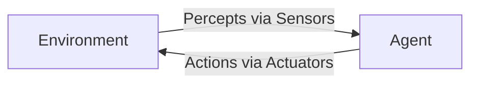
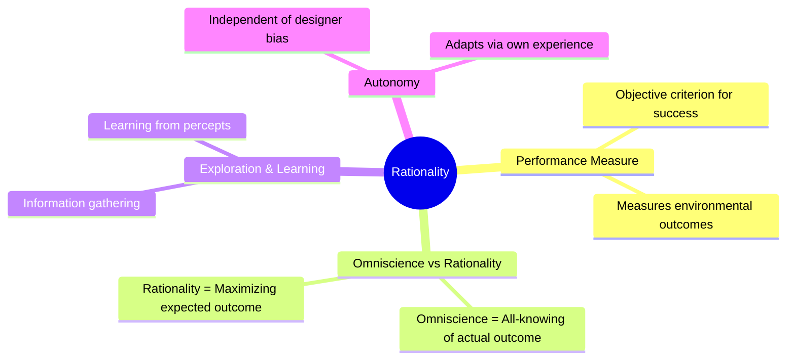
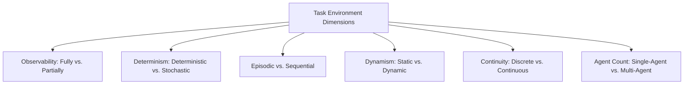
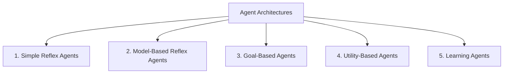
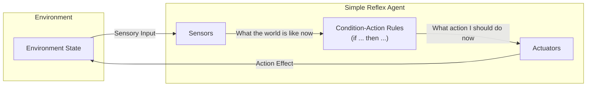
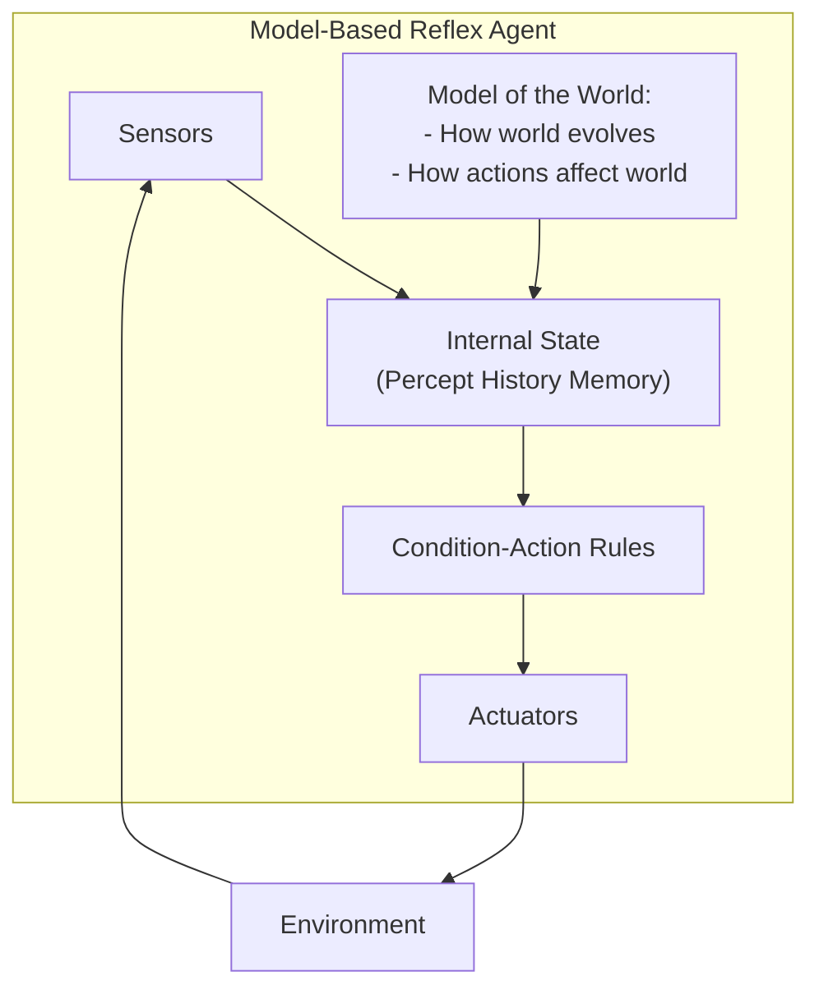
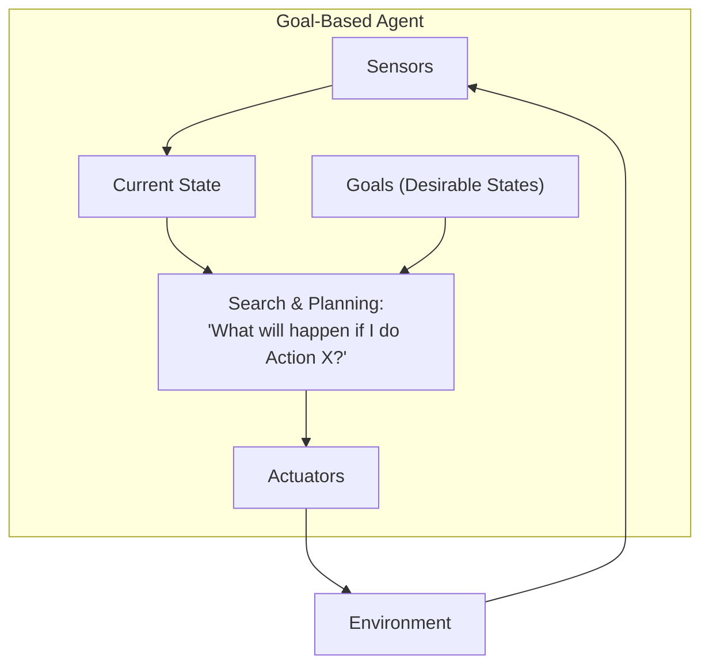
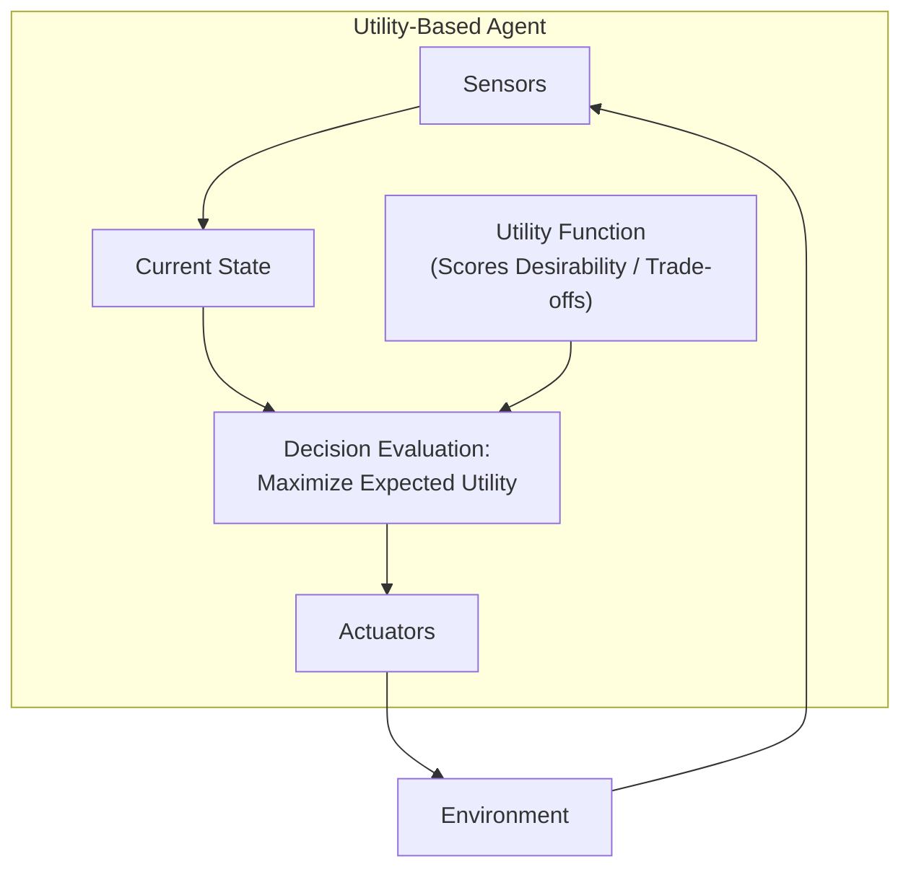
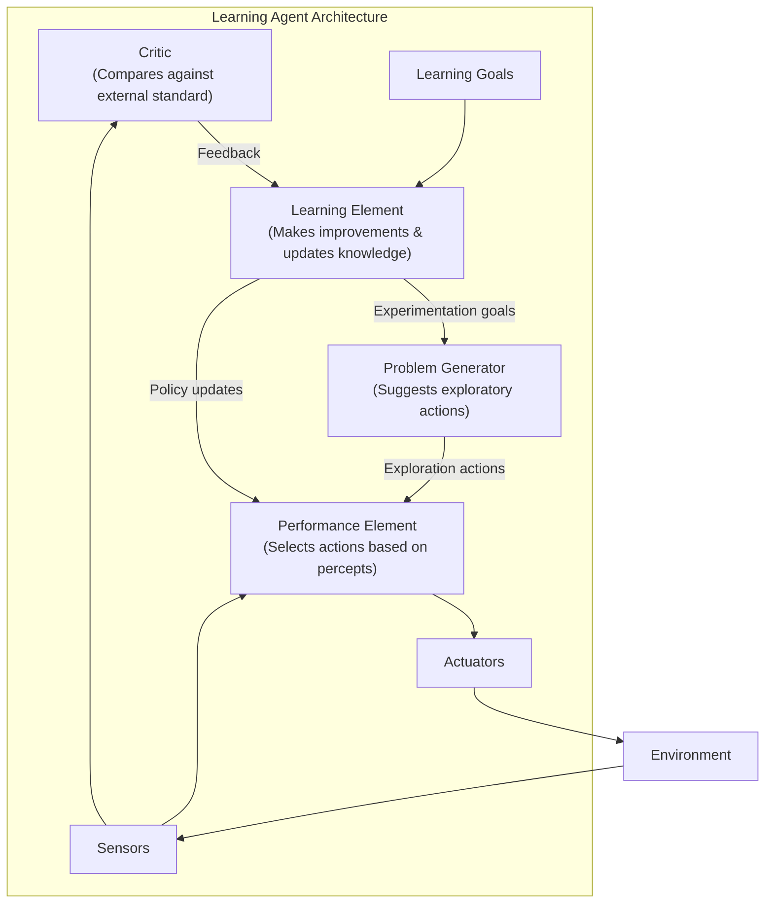

# Lecture 1: Intelligent Agents

---

## 1. Introduction & Overview

An **Intelligent Agent** is the foundational paradigm of modern Artificial Intelligence. Rather than viewing AI merely as isolated algorithms, the agent-based approach conceptualizes systems that interact with their surrounding environments to achieve specific goals.

```
+-------------------------------------------------------+
|                        AGENT                          |
|                                                       |
|                     [ Sensors ]                       |
|                          ^                            |
|                          | Percepts                   |
|                          |                            |
|                 [ Agent Function ]                    |
|                 [ Architecture   ]                    |
|                          |                            |
|                          | Actions                    |
|                          v                            |
|                    [ Actuators ]                      |
+-------------------------------------------------------+
                           ^
                           | (Interacts with)
                           v
                  [ Environment ]
```

### Lecture Outline
1. **Agents and Environments:** Formal definitions, architecture, and agent functions.
2. **The Vacuum-Cleaner World:** A classic illustrative toy problem.
3. **Rationality:** Performance measures, autonomy, exploration, and rational behavior.
4. **PEAS Framework:** Performance measure, Environment, Actuators, and Sensors.
5. **Environment Types:** Dimensional taxonomy of task environments.
6. **Agent Implementations & Limitations:** Table-lookup agents and combinatorial explosion.
7. **The Four (Five) Basic Agent Architectures:** Simple reflex, model-based reflex, goal-based, utility-based, and learning agents.

---

## 2. Agents and Environments

### Definitions
* **Agent:** Anything that can be viewed as perceiving its environment through **sensors** and acting upon that environment through **actuators**.
* **Percept:** The agent's perceptual input at any given instant.
* **Percept Sequence:** The complete history of everything the agent has ever perceived:
  $$P^* = [p_1, p_2, \dots, p_t]$$

### Examples of Agents

| Agent Type | Sensors | Actuators |
| :--- | :--- | :--- |
| **Human Agent** | Eyes, ears, nose, skin, and other sensory organs | Hands, legs, mouth, vocal cords, muscles |
| **Robotic Agent** | Cameras, infrared range finders, LIDAR, sonar | Electric motors, wheels, robotic arms, grippers |
| **Software / Web Agent** | Keystrokes, file contents, network packets | Display output, file writes, sending network packets |

### Formal Mathematical Formulation
* **Agent Function ($f$):** An abstract mathematical mapping from any percept history to an action:
  $$f: P^* \to A$$
* **Agent Program:** The concrete physical implementation that executes on the computing architecture to produce $f$.
* **Core Agent Equation:**
  $$\text{Agent} = \text{Architecture} + \text{Program}$$
  * **Architecture:** The physical computing device equipped with hardware sensors and actuators.
  * **Program:** The software algorithm that processes sensory inputs and selects actuator commands.

### Interaction Architecture



---

## 3. Illustrative Example: The Vacuum-Cleaner World

The vacuum-cleaner world is a canonical toy problem with two locations: Square $A$ and Square $B$.

```
+-------------------+-------------------+
|     Square A      |     Square B      |
|                   |                   |
|      [Robot]      |      [Dirt]       |
|      [Dirt]       |                   |
+-------------------+-------------------+
```

### Environment Specification
* **Percepts:** An ordered pair containing the current location and cleanliness status:
  $$[\text{Location}, \text{Status}] \in \{A, B\} \times \{\text{Clean}, \text{Dirty}\}$$
* **Possible Sensor Inputs (Instantaneous):** 
  $$[A, \text{Clean}], [A, \text{Dirty}], [B, \text{Clean}], [B, \text{Dirty}]$$
* **Actions Available:**
  $$\{\text{Left}, \text{Right}, \text{Suck}, \text{NoOp}\}$$

### Partial Agent Function (Lookup Table)

| Percept Sequence | Action |
| :--- | :--- |
| $[A, \text{Clean}]$ | $\text{Right}$ |
| $[A, \text{Dirty}]$ | $\text{Suck}$ |
| $[B, \text{Clean}]$ | $\text{Left}$ |
| $[B, \text{Dirty}]$ | $\text{Suck}$ |
| $[A, \text{Clean}], [A, \text{Clean}]$ | $\text{Right}$ |
| $[A, \text{Clean}], [A, \text{Dirty}]$ | $\text{Suck}$ |
| $\dots$ | $\dots$ |

### Simple Reflex Vacuum Program

```text
function REFLEX-VACUUM-AGENT([location, status]) returns an action
    if status == Dirty then 
        return Suck
    else if location == A then 
        return Right
    else if location == B then 
        return Left
```

---

## 4. Rationality

### What is a Rational Agent?
An agent should strive to **"do the right thing"**, which is the action that will cause the agent to be most successful.

> **Formal Definition of a Rational Agent:**  
> For each possible percept sequence, a rational agent selects an action that is expected to **maximize its performance measure**, given the evidence provided by the percept sequence and whatever built-in knowledge the agent possesses.

### Key Dimensions of Rationality



1. **Performance Measure:**
   * An objective criterion for evaluating the success of an agent's behavior in the environment.
   * *Rule of thumb:* Measure **what** you want in the environment (e.g., cleanliness of floor, energy efficiency), not **how** you think the agent should behave.
   * *Vacuum example:* Amount of dirt cleaned, time taken, electricity consumed, noise generated.
2. **Rationality $\neq$ Omniscience:**
   * **Omniscience:** Knowing the actual outcome of actions in advance (impossible in the real world).
   * **Rationality:** Making the optimal decision based on *expected* success given available data.
3. **Exploration & Information Gathering:**
   * Rational agents perform exploratory actions to modify future percepts and gain vital information (e.g., looking both ways before crossing).
4. **Learning & Adaptation:**
   * Rational agents update internal models and extend prior knowledge based on observations over time.
5. **Autonomy:**
   * An agent is autonomous if its behavior is determined by its own experience rather than solely relying on the prior knowledge of its designer.
   * A non-autonomous agent relies entirely on built-in assumptions, failing whenever the environment departs from expectations.

---

## 5. The PEAS Framework

Before designing an agent, the task environment must be formally specified using the **PEAS** description:
* **P** — **P**erformance Measure
* **E** — **E**nvironment
* **A** — **A**ctuators
* **S** — **S**ensors

### PEAS Examples

| Agent Type | Performance Measure (**P**) | Environment (**E**) | Actuators (**A**) | Sensors (**S**) |
| :--- | :--- | :--- | :--- | :--- |
| **Automated Taxi Driver** | Safe, fast, legal trip; passenger comfort; maximized profits / minimized costs | Roads, other vehicles, pedestrians, weather conditions, customers | Steering wheel, accelerator pedal, brake, turn signals, horn, display/voice | Cameras, LIDAR/sonar, speedometer, GPS, odometer, engine sensors, touch input |
| **Medical Diagnosis System** | Healthy patient, minimized costs, avoidance of malpractice/lawsuits | Patient, medical staff, hospital system | Screen display (questions, test orders, diagnosis, prescriptions, referrals) | Keyboard, touchscreen, electronic medical record (EMR) input |
| **Part-Picking Robot** | Percentage of parts placed into correct bins, throughput rate, zero damage | Conveyor belt with moving parts, sorting bins | Jointed robotic arm, pneumatic/magnetic gripper | High-resolution camera, joint angle sensors, tactile sensors |
| **Interactive English Tutor** | Maximized student test scores, engagement, customized learning pace | Set of students, curriculum, testing platform | Screen display of exercises, hints, explanations, corrections | Keyboard input, mouse clicks, audio microphone |

---

## 6. Environment Types

Task environments are classified across six major dimensional axes:



### 1. Fully Observable vs. Partially Observable
* **Fully Observable:** Sensors detect the complete state of the environment at any point in time relevant to action selection.
  * *Example:* Chess (the entire board state is visible).
* **Partially Observable:** Parts of the state are missing, noisy, or unobservable due to sensor limits or occlusions.
  * *Example:* Driving a car (cannot see around blind corners or through buildings; radar noise).

### 2. Deterministic vs. Stochastic
* **Deterministic:** The next state of the environment is completely determined by the current state and the action executed by the agent.
  * *Example:* Solving a math equation or a deterministic grid puzzle.
* **Stochastic:** The next state involves randomness or uncertain transitions.
  * *Example:* Rolling dice, driving in unpredictable traffic.
  * *(Note: If an environment is partially observable, it may appear stochastic to the agent).*

### 3. Episodic vs. Sequential
* **Episodic:** The agent's experience is divided into independent atomic episodes. The action chosen in the current episode does not affect future episodes.
  * *Example:* Defect detection on an assembly line; classifying individual static images.
* **Sequential:** Current actions have long-term consequences on future decisions and states.
  * *Example:* Chess, driving, navigating a maze.

### 4. Static vs. Dynamic
* **Static:** The environment does not change while the agent is deliberating.
  * *Example:* Crossword puzzle, Sudoku.
* **Dynamic:** The environment continuously changes while the agent decides what action to take.
  * *Example:* Driving in traffic, competitive video games.
  * *(Semi-dynamic: The environment does not change with time, but the agent's performance score does, e.g., chess with a clock).*

### 5. Discrete vs. Continuous
* **Discrete:** The state space, time, percepts, and actions are distinct and countable.
  * *Example:* Chess (distinct squares, discrete turns, finite possible legal moves).
* **Continuous:** State variables, percepts, or actions vary smoothly over real numbers ($\mathbb{R}$).
  * *Example:* Steering angles and speed of an autonomous vehicle; robotic joint positions.

### 6. Single-Agent vs. Multi-Agent
* **Single-Agent:** An agent operating by itself in an environment without competing or collaborating entities.
  * *Example:* Solving a crossword puzzle.
* **Multi-Agent:** Multiple agents operating within the same environment.
  * *Competitive:* Maximizing own score minimizes another agent's score (e.g., Chess).
  * *Cooperative:* Agents coordinate to achieve shared goals (e.g., Swarm robotics).

### Environment Comparison Matrix

| Environment | Observable | Deterministic | Episodic | Static | Discrete | Agents |
| :--- | :--- | :--- | :--- | :--- | :--- | :--- |
| **Chess (with clock)** | Fully | Deterministic | Sequential | Semi | Discrete | Multi (Competitive) |
| **Crossword Puzzle** | Fully | Deterministic | Sequential | Static | Discrete | Single |
| **Poker** | Partially | Stochastic | Sequential | Static | Discrete | Multi (Competitive) |
| **Medical Diagnosis** | Partially | Stochastic | Sequential | Dynamic | Continuous | Single |
| **Autonomous Driving** | Partially | Stochastic | Sequential | Dynamic | Continuous | Multi |

> [!NOTE]
> * **Simplest Environment:** Fully observable, deterministic, episodic, static, discrete, and single-agent.
> * **Most Challenging Environment:** Partially observable, stochastic, sequential, dynamic, continuous, and multi-agent (characterizes most real-world AI applications).

---

## 7. Agent Programs & Table-Driven Agents

### The Table-Driven Approach
The simplest theoretical implementation of an agent function is an explicit lookup table indexed by percept histories.

```text
function TABLE-DRIVEN-AGENT(percept) returns an action
    persistent: percepts, a sequence initially empty
                table, a table of actions indexed by percept sequences

    append percept to the end of percepts
    action <- LOOKUP(percepts, table)
    return action
```

### The Combinatorial Explosion Problem
Suppose an agent operates for $T$ time steps, and there are $|P|$ possible distinct percepts at each step:
* The number of possible percept sequences of length $T$ is:
  $$|P|^T$$
* The total number of table entries required across all histories up to horizon $T$ is:
  $$\sum_{t=1}^{T} |P|^t$$

#### Concrete Example:
* In the toy vacuum world: $|P| = 4$ possible percepts.
  * For $T = 20$ steps:
    $$4^{20} \approx 1.1 \times 10^{12} \text{ table entries}$$
* In realistic environments: $|P| \ge 100$.
  * For $T = 20$ steps:
    $$100^{20} = 10^{40} \text{ entries}$$
    *(By comparison, $10^{40}$ vastly exceeds storage capacity and practical feasibility).*

### Fatal Drawbacks of Table Lookup
1. **Intractable Storage:** Requires exponentially huge memory.
2. **Impractical Construction Time:** No designer can manually construct all entries.
3. **Absence of Autonomy:** The agent cannot handle unexpected or novel percept sequences.
4. **Learning Impasse:** Even with machine learning, exploring and learning $10^{40}$ entries requires impractically infinite training time.

**Conclusion:** Intelligent agents require compact, structured representations (rules, internal states, goals, utility models, and neural approximations).

---

## 8. The Basic Agent Architectures

AI agents are categorized into five primary architectures of increasing capability and generality:



---

### 1. Simple Reflex Agents

Simple reflex agents select actions based solely on the **current percept**, completely ignoring the percept history.



#### Pseudocode
```text
function SIMPLE-REFLEX-AGENT(percept) returns an action
    persistent: rules, a set of condition-action rules

    state  <- INTERPRET-INPUT(percept)
    rule   <- RULE-MATCH(state, rules)
    action <- RULE-ACTION[rule]
    return action
```

* **Condition-Action Rule:** `if condition then action`  
  * *Example:* `if status == Dirty then return Suck`
* **Limitation:** Simple reflex agents succeed **only** if the environment is **fully observable**. In partially observable environments, unobserved states lead to ambiguous decisions and fatal infinite loops.

---

### 2. Model-Based Reflex Agents

To overcome partial observability, a model-based agent maintains an **internal state** that tracks aspects of the environment currently invisible to its sensors.



#### Key Components:
1. **Internal State:** Reflects current beliefs about the environment.
2. **Transition Model:** Knowledge of how the world changes independently of the agent.
3. **Sensor/Action Model:** Knowledge of how the agent's own actions transform the environment.

#### Pseudocode
```text
function REFLEX-AGENT-WITH-STATE(percept) returns an action
    persistent: state, a description of the current world state
                rules, a set of condition-action rules
                action, the most recent action executed

    state  <- UPDATE-STATE(state, action, percept)
    rule   <- RULE-MATCH(state, rules)
    action <- RULE-ACTION[rule]
    return action
```

---

### 3. Goal-Based Agents

Knowing the current state is not always sufficient to decide what to do; the agent must also possess **goal descriptions** that specify desirable situations.



* **Core Mechanism:** Incorporates **Search and Planning** algorithms to evaluate multi-step action sequences.
* **Key Advantage:** Far more flexible than reflex agents. If destination/goals change, the agent updates its goal specification rather than requiring a complete rewriting of condition-action rules.
* **Major Difference:** The agent deliberately considers the **future** impact of candidate actions.

---

### 4. Utility-Based Agents

Goals provide only a crude binary distinction between winning and losing states (satisfied vs. unsatisfied). A **Utility Function** maps an environment state (or sequence of states) to a real number measuring degree of preference or "happiness":
$$U: S \to \mathbb{R}$$



#### Why Utility is Essential:
1. **Conflicting Goals:** Provides principled trade-offs between competing criteria (e.g., speed vs. safety vs. fuel economy in an automated taxi).
2. **Uncertainty & Risk:** When outcomes are stochastic, utility theory calculates the **Expected Utility**:
   $$\mathbb{E}[U(a)] = \sum_{s'} P(s' \mid s, a) \cdot U(s')$$
   A rational agent selects the action that maximizes expected utility.

---

### 5. Learning Agents

All preceding agent programs assume that action-selection logic is hardcoded by the developer. A **Learning Agent** separates operational action selection from behavioral improvement, enabling the agent to operate in initially unknown environments.



#### The Four Core Components:
1. **Performance Element:** The existing agent program responsible for selecting external actions based on percepts (e.g., reflex, goal, or utility engine).
2. **Critic:** Evaluates the agent's behavior against an external, fixed performance standard and supplies evaluative feedback.
3. **Learning Element:** Utilizes feedback from the critic to adjust and improve the performance element.
4. **Problem Generator:** Proposes novel exploratory actions that may be suboptimal in the short term but discover valuable new knowledge for long-term optimization.

---

## 9. Comparative Summary of Agent Architectures

| Architecture | Basis for Action Selection | Maintains History? | Handles Partial Observability? | Adaptability / Flexibility |
| :--- | :--- | :--- | :--- | :--- |
| **Simple Reflex** | Current percept only via condition-action rules | No | No (risks infinite loops) | Low (rigid rules) |
| **Model-Based Reflex** | Current percept + internal state model | Yes | Yes (tracks hidden variables) | Moderate (model-dependent) |
| **Goal-Based** | Current state + search toward explicit goal states | Yes | Yes | High (goals are reprogrammable) |
| **Utility-Based** | Current state + optimization of real-valued utility | Yes | Yes | Very High (balances competing goals & risk) |
| **Learning Agent** | Performance element guided by critic and problem generator | Yes | Yes | Maximum (adapts to unknown environments) |

---

## 10. Key Takeaways

1. **Agent Paradigm:** An agent perceives through sensors, acts through actuators, and is mathematically characterized by an agent function $f: P^* \to A$ running on an architecture.
2. **Rationality is Not Perfection:** Rational agents maximize *expected* performance given their percept sequence and built-in knowledge; they need not be omniscient.
3. **PEAS is Fundamental:** Designing an AI system requires formalizing Performance measure, Environment, Actuators, and Sensors before selecting algorithms.
4. **Environment Difficulty Spectrum:** The easiest environment is fully observable, deterministic, episodic, static, discrete, and single-agent; real-world environments are typically the exact opposite.
5. **Table Lookup Fails:** Percept sequences grow exponentially ($|P|^T$), necessitating compact, structured agent architectures.
6. **Hierarchical Progression of Agents:** From simple reflex condition-action pairs, to internal models, to goal-oriented search, to utility maximization, and finally to self-improving learning agents.

