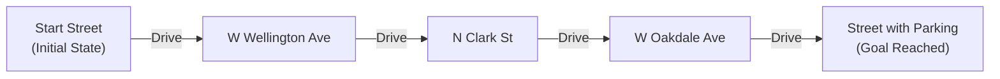
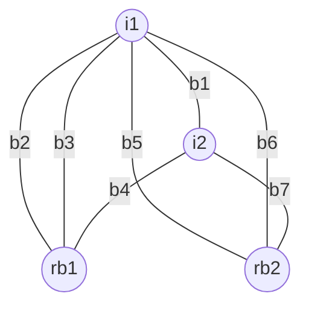
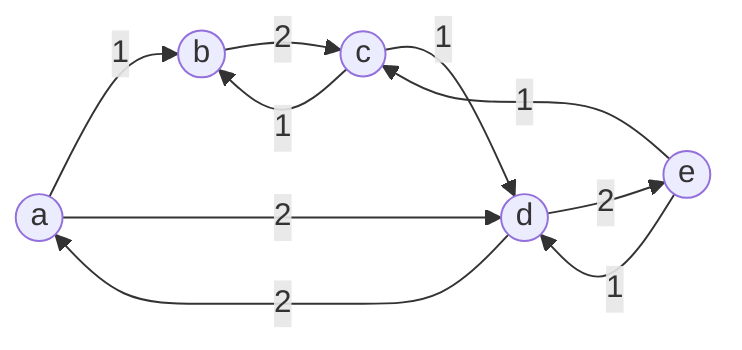
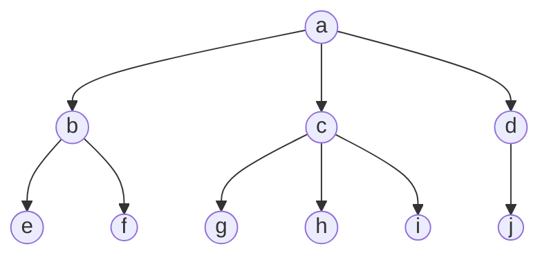
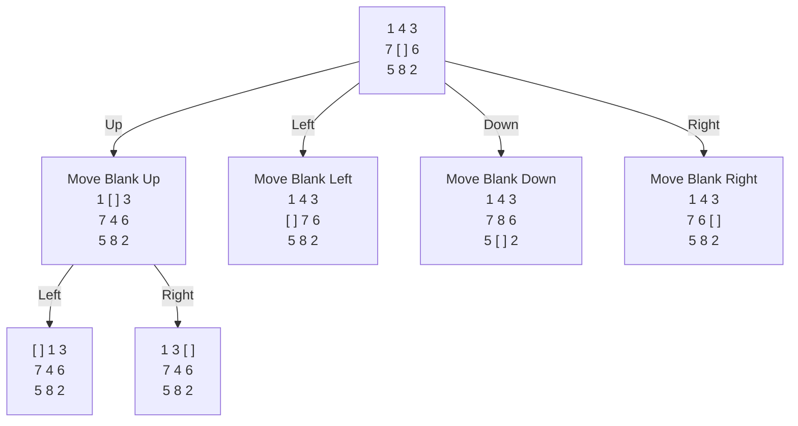
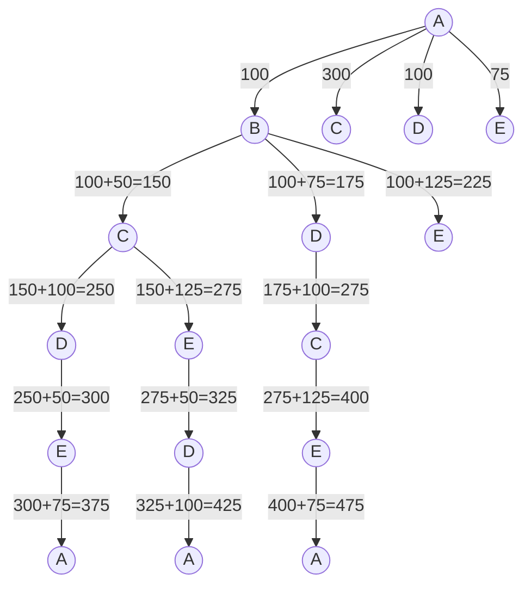
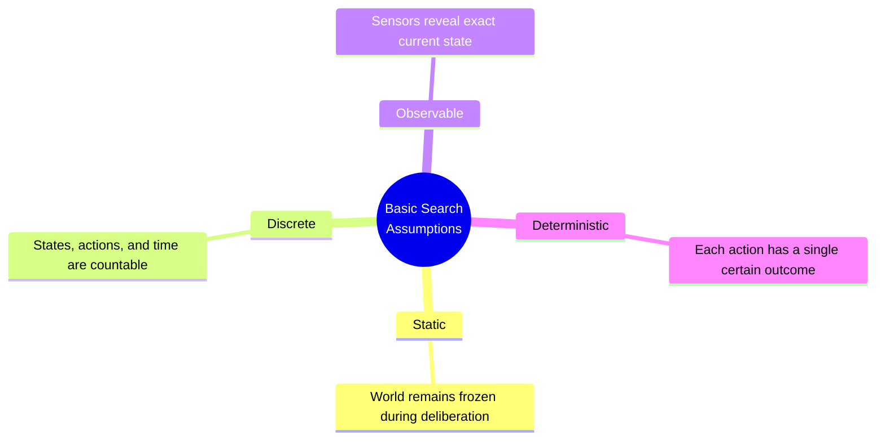
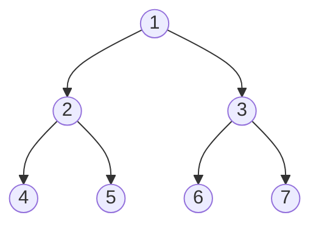

# Lecture 2: Problem Solving Using Search

---

## Executive Summary

This lecture establishes the foundational principles of **Problem Solving Using Search** in Artificial Intelligence. When an intelligent agent does not know the immediate solution to a problem, it formulates a **goal**, defines a **problem space**, and conducts a systematic **search** through a state space to discover an optimal sequence of actions.

```
+-------------------------------------------------------------------------+
|                        PROBLEM-SOLVING AGENT                            |
|                                                                         |
|   Sensors ---> [ 1. Formulate Goal ]                                    |
|                       |                                                 |
|                       v                                                 |
|                [ 2. Formulate Problem ] (States, Actions)               |
|                       |                                                 |
|                       v                                                 |
|                [ 3. Find Solution (Search) ]                            |
|                       |                                                 |
|                       v                                                 |
|   Actuators <-- [ 4. Execute Actions (Perform Solution) ]                |
+-------------------------------------------------------------------------+
                            ^
                            | Percepts / Actions
                            v
                     [ Environment ]
```

### Core Takeaways

1. **Agent Problem-Solving Cycle:**
   * **Formulate Goal:** Determine what the world should look like (e.g., "Car is parked").
   * **Formulate Problem:** Define states and operators/actions (e.g., street segments and driving actions).
   * **Find Solution:** Search through candidate action sequences before executing anything.
   * **Execute:** Carry out the actions one by one in the real environment.

2. **Graph Theory as Problem Formulation:**
   * Grounded in Leonhard Euler's 1736 solution to the **Seven Bridges of Königsberg**.
   * A problem space is mathematically formalized as a 4-tuple:
     $$[N, A, S, GD]$$
     where $N$ = state space (nodes), $A$ = operators (arcs), $S$ = initial state(s), and $GD$ = goal state(s).

3. **Core Search Problem Assumptions:**
   * The basic search formulation assumes the environment is **static**, **discrete**, **observable**, and **deterministic**.

4. **Search Node Architecture:**
   * A search node contains: `[STATE, PARENT, ACTION, COST, DEPTH]`.
   * Unexpanded frontier nodes reside in the **Fringe (`OPEN` list)**; the queuing policy determines the search strategy.
   * **Memory Tip:** If full state representations are too large, store only the initial state and reconstruct/regenerate states dynamically on demand.

5. **Uninformed vs. Informed Search:**
   * **Uninformed (Blind):** BFS (queue, $O(b^d)$ space), DFS (stack, $O(b \cdot m)$ space), DLS (cutoff $k$), IDS (best of both: complete, optimal, $O(b \cdot d)$ linear memory), Bidirectional ($O(b^{d/2})$).
   * **Informed (Heuristic):** Greedy Best-First ($f = h$, fast but sub-optimal), A* ($f = g + h$, complete & optimal with admissible heuristics), IDA* (depth-first $f$-cutoff search, optimal with $O(b \cdot d)$ memory).

---

## Table of Contents

- [Executive Summary](#executive-summary)
  - [Core Takeaways](#core-takeaways)
- [1. The Problem-Solving Agent Framework](#1-the-problem-solving-agent-framework)
  - [1.1 The Internal Agent Cycle](#11-the-internal-agent-cycle)
  - [1.2 Motivating Example: Looking for Street Parking](#12-motivating-example-looking-for-street-parking)
  - [1.3 Simple Problem-Solving Agent Algorithm](#13-simple-problem-solving-agent-algorithm)
- [2. Mathematical Foundations: Graph Theory & The City Bridge System](#2-mathematical-foundations-graph-theory--the-city-bridge-system)
  - [2.1 The Seven Bridges of Königsberg](#21-the-seven-bridges-of-königsberg)
  - [2.2 Graph Representation of the City Bridge System](#22-graph-representation-of-the-city-bridge-system)
  - [2.3 Path Representation Schemes](#23-path-representation-schemes)
- [3. Formal Graph Definitions & Tree Terminology](#3-formal-graph-definitions--tree-terminology)
  - [3.1 Basic Graph Definitions](#31-basic-graph-definitions)
  - [3.2 Labeled Directed Graph Example](#32-labeled-directed-graph-example)
  - [3.3 Trees & Family Relationship Analogies](#33-trees--family-relationship-analogies)
  - [3.4 Paths, Ancestors, Cycles, and Connectivity](#34-paths-ancestors-cycles-and-connectivity)
- [4. State Space Representation & Problem Formalization](#4-state-space-representation--problem-formalization)
  - [4.1 Newell and Simon's Unifying View](#41-newell-and-simons-unifying-view)
  - [4.2 The 4-Tuple Formalization: $[N, A, S, GD]$](#42-the-4-tuple-formalization-n-a-s-gd)
  - [4.3 Example 1: The 8-Puzzle Problem](#43-example-1-the-8-puzzle-problem)
  - [4.4 Example 2: Traveling Salesman Problem (TSP)](#44-example-2-traveling-salesman-problem-tsp)
    - [The 5-City Instance](#the-5-city-instance)
    - [Search Tree Exploration & Minimal Cost Path](#search-tree-exploration--minimal-cost-path)
    - [The Greedy Trap: Nearest Neighbor vs. Optimal Minimal Cost](#the-greedy-trap-nearest-neighbor-vs-optimal-minimal-cost)
- [5. Defining the Search Problem & Core Assumptions](#5-defining-the-search-problem--core-assumptions)
  - [5.1 The 5 Components of a Search Problem](#51-the-5-components-of-a-search-problem)
  - [5.2 Foundational Assumptions of Basic Search](#52-foundational-assumptions-of-basic-search)
  - [5.3 Search Space Size & Combinatorial Explosion](#53-search-space-size--combinatorial-explosion)
- [6. Search Tree Mechanics & Node Data Structures](#6-search-tree-mechanics--node-data-structures)
  - [6.1 Simplified Search Loop](#61-simplified-search-loop)
  - [6.2 Search Tree vs. State Space](#62-search-tree-vs-state-space)
  - [6.3 Search Node Data Structure](#63-search-node-data-structure)
  - [6.4 The Fringe (`OPEN` List) & Queuing Policy](#64-the-fringe-open-list--queuing-policy)
  - [6.5 Search Strategy Evaluation Dimensions](#65-search-strategy-evaluation-dimensions)
- [7. Uninformed (Blind) Search Strategies](#7-uninformed-blind-search-strategies)
  - [7.1 Breadth-First Search (BFS)](#71-breadth-first-search-bfs)
  - [7.2 Bidirectional Search](#72-bidirectional-search)
  - [7.3 Depth-First Search (DFS)](#73-depth-first-search-dfs)
  - [7.4 Depth-Limited Search (DLS)](#74-depth-limited-search-dls)
  - [7.5 Iterative Deepening Search (IDS / IDDFS)](#75-iterative-deepening-search-ids--iddfs)
  - [7.6 Comparative Summary of Uninformed Strategies](#76-comparative-summary-of-uninformed-strategies)
  - [7.7 Graph Search: Avoiding Repeated States & Cycles](#77-graph-search-avoiding-repeated-states--cycles)
- [8. Informed (Heuristic) Search Strategies](#8-informed-heuristic-search-strategies)
  - [8.1 The Heuristic Function $h(n)$](#81-the-heuristic-function-hn)
  - [8.2 Greedy Best-First Search](#82-greedy-best-first-search)
  - [8.3 A* Search](#83-a-search)
  - [8.4 Iterative-Deepening A* (IDA*)](#84-iterative-deepening-a-ida)
- [9. Academic Assessment Roadmap](#9-academic-assessment-roadmap)
- [10. Key Takeaways & Review Checklist](#10-key-takeaways--review-checklist)

---

## 1. The Problem-Solving Agent Framework

### 1.1 The Internal Agent Cycle

A **Problem-Solving Agent** is a specialized goal-based agent that plans ahead by discovering sequences of actions that lead from an initial state to a desirable goal state before executing any physical action.

```
       +---------------------------------------------------------+
       |                  Problem-Solving Agent                  |
       |                                                         |
       |    Sensors ---> [ 1. Formulate Goal ]                   |
       |                        |                                |
       |                        v                                |
       |                 [ 2. Formulate Problem ]                |
       |                   - States                              |
       |                   - Actions                             |
       |                        |                                |
       |                        v                                |
       |                 [ 3. Find Solution (Search) ]           |
       |                        |                                |
       |                        v                                |
       |    Actuators <-- [ 4. Perform Solution ]                |
       +---------------------------------------------------------+
                                    ^
                                    | Interaction
                                    v
                             [ Environment ]
```

#### The Four Distinct Phases:
1. **Formulate Goal:** Define the target satisfaction criteria (based on current percepts and performance measure).
2. **Formulate Problem:** Define the abstractions for what constitutes a *state* and which *actions* are permissible.
3. **Search:** Run an offline algorithm over the state space model to synthesize a path (action sequence).
4. **Execution:** Execute the actions in the physical environment sequentially.

---

### 1.2 Motivating Example: Looking for Street Parking

Consider an everyday scenario: you are driving home and need to park your car on the street.



#### Problem Formulation Breakdown:
* **Current Context:** Returning home; need to find an available curbside parking spot.
* **Formulate Goal:**
  $$\text{Goal: } \text{"Car is parked legally"}$$
* **Formulate Problem:**
  * **States:** Discrete street segments, including occupancy information (e.g., which street segments currently have available parking spots and cars present).
  * **Actions:** Drive between contiguous street segments (turn left, turn right, go straight).
* **Find Solution:**
  * A sequence of street segments starting at the current street segment and terminating at a street segment with an empty parking spot.
* **Execution:** Drive along the calculated search path and park.

---

### 1.3 Simple Problem-Solving Agent Algorithm

```text
Algorithm: Problem-Solving-Agent
Input: percept (perceptual input from environment)
Persistent State: 
    seq, an action sequence, initially empty
    state, some description of the current world state
    goal, a goal, initially null
    problem, a problem formulation

1. state  <- UPDATE-STATE(state, percept)
2. IF seq is empty THEN
3.     goal      <- FORMULATE-GOAL(state)
4.     problem   <- FORMULATE-PROBLEM(state, goal)
5.     seq       <- SEARCH(problem)
6.     IF seq == Failure THEN RETURN a null action
7. action <- FIRST(seq)
8. seq    <- REST(seq)
9. RETURN action
```

---

## 2. Mathematical Foundations: Graph Theory & The City Bridge System

### 2.1 The Seven Bridges of Königsberg

Graph theory was born in 1736 when Swiss mathematician **Leonhard Euler** solved the **Seven Bridges of Königsberg** problem:

* The city of Königsberg was divided by the Pregel River into four landmasses: **Riverbank 1 ($rb_1$)**, **Riverbank 2 ($rb_2$)**, **Island 1 ($i_1$)**, and **Island 2 ($i_2$)**.
* Seven bridges connected the landmasses:
  * Two bridges ($b_2, b_3$) connected Island 1 to Riverbank 1.
  * Two bridges ($b_5, b_6$) connected Island 1 to Riverbank 2.
  * One bridge ($b_1$) connected Island 1 to Island 2.
  * One bridge ($b_4$) connected Island 2 to Riverbank 1.
  * One bridge ($b_7$) connected Island 2 to Riverbank 2.

```
                  [ Riverbank 1 (rb1) ]
                  /        |         \
              b2 /      b3 |          \ b4
                /          |           \
        [ Island 1 (i1) ] --- b1 --- [ Island 2 (i2) ]
                \          |           /
              b5 \      b6 |          / b7
                  \        |         /
                  [ Riverbank 2 (rb2) ]
```

> **The Question:** Is there a continuous walk through the city that crosses **each bridge exactly once** (an Eulerian path)?  
> **Euler's Insight:** An Eulerian path requires that all vertices (or all except the start and end) have an **even degree** (number of connected edges). In Königsberg:
> * $\text{deg}(i_1) = 5$ (Odd)
> * $\text{deg}(i_2) = 3$ (Odd)
> * $\text{deg}(rb_1) = 3$ (Odd)
> * $\text{deg}(rb_2) = 3$ (Odd)  
> Because all four regions have an odd number of bridges, **such a walk is mathematically impossible**.

---

### 2.2 Graph Representation of the City Bridge System

Euler abstracted away the geography, retaining only topological connectivity:



* **Nodes (Vertices):** Landmasses representing **States**:
  $$V = \{i_1, i_2, rb_1, rb_2\}$$
* **Arcs (Edges):** Bridges representing **Actions/Transitions**:
  $$E = \{(i_1, rb_1)_{b_2}, (i_1, rb_1)_{b_3}, (i_1, rb_2)_{b_5}, (i_1, rb_2)_{b_6}, (i_1, i_2)_{b_1}, (i_2, rb_1)_{b_4}, (i_2, rb_2)_{b_7}\}$$

---

### 2.3 Path Representation Schemes

When representing a trajectory through the bridge graph, two equivalent formalisms exist:

1. **Initial State + Action Sequence:**
   $$[i_1, b_2, b_3, b_1, b_4, \dots]$$
   *(Specify starting node followed by the exact sequence of operator labels).*
2. **State Sequence:**
   $$[i_1, rb_1, i_2, rb_2, \dots]$$
   *(Specify the ordered sequence of states traversed).*

---

## 3. Formal Graph Definitions & Tree Terminology

### 3.1 Basic Graph Definitions
* **Graph:** An algebraic structure $G = (V, E)$ consisting of:
  * A set of **Nodes / Vertices** ($V$), which may be finite or infinite (representing states).
  * A set of **Arcs / Edges** ($E$), which connect pairs of nodes (representing actions/operators).
* **Arc:** An ordered pair of nodes $(u, v)$:
  * $u$ = Start Node / Origin
  * $v$ = End Node / Destination

---

### 3.2 Labeled Directed Graph Example

Consider a directed graph with transition weights:



* **Node Set:** $V = \{a, b, c, d, e\}$
* **Arc Set:** $E = \{(a, b), (a, d), (b, c), (c, b), (c, d), (d, a), (d, e), (e, c), (e, d)\}$
* **Parent-Child Relation:** Because $(e, c) \in E$, node **$e$ is a parent of node $c$**, and **$c$ is a child of $e$**.

---

### 3.3 Trees & Family Relationship Analogies

A graph can be analyzed using genealogical terminology:



* **Parent & Child:** In a directed arc $N \to M$, $N$ is the **parent** and $M$ is the **child**.
* **Siblings:** If $N \to M$ and $N \to K$, then $M$ and $K$ are **siblings** (e.g., $b, c, d$ are siblings sharing parent $a$).
* **Rooted Tree:** A directed acyclic graph possessing a unique node with **no parents** (the **root**, $a$). All directed edges flow strictly away from the root, and every other node has **exactly one parent**.
* **Leaf (Tip / Dead End) Node:** Any node that has **no children** (e.g., $e, f, g, h, i, j$).

---

### 3.4 Paths, Ancestors, Cycles, and Connectivity

* **Path:** An ordered sequence of $n+1$ nodes:
  $$[v_0, v_1, v_2, \dots, v_n]$$
  such that $(v_i, v_{i+1}) \in E$ for all $0 \le i < n$.
  * The **Length of a Path** is the number of arcs, which equals $n$.
  * *Example:* $[a, b, e]$ contains 3 nodes and has a **length of 2**.
* **Ancestor & Descendant:** Along a path in a rooted tree, any node appearing *before* a given node (to its left) is an **ancestor**; any node appearing *after* it (to its right) is a **descendant**.
* **Cycle (Loop):** A path that visits any single node more than once (e.g., $b \to c \to b$).
* **Tree Definition:** A graph in which there exists a **unique simple path** between every pair of nodes (**no cycles**).
* **Connected:** Two nodes are connected if at least one path exists containing both nodes.

---

## 4. State Space Representation & Problem Formalization

### 4.1 Newell and Simon's Unifying View

In their seminal work on the General Problem Solver, Allen Newell and Herbert Simon formalized human and artificial problem solving as navigation through a **Problem Space**:

1. **State Space:** The set of all possible configurations of the problem domain.
2. **Set of Operators:** Transformations that alter one state into another.

> **Graph Mapping:**  
> The problem space is represented as a directed graph where **nodes = states** and **arcs = operators**.

---

### 4.2 The 4-Tuple Formalization: $[N, A, S, GD]$

Any state space search problem is completely specified by the 4-tuple:

$$[N, A, S, GD]$$

| Element | Description |
| :---: | :--- |
| **$N$** | The **problem space** (set of all reachable states / nodes). |
| **$A$** | The set of **arcs** between nodes, corresponding to valid operator transitions. |
| **$S$** | A non-empty subset of $N$ ($S \subseteq N$) representing the **start / initial state(s)**. |
| **$GD$** | A non-empty subset of $N$ ($GD \subseteq N$) representing the **goal state(s)**. |

#### Goal State ($GD$) Specifications:
* **Explicit Property:** Described by a measurable condition/predicate (e.g., `CarIsParked == True` or `IsSorted(board)`).
* **Path Property:** Described by a property of the path constructed during search (e.g., "shortest tour visiting all cities").

---

### 4.3 Example 1: The 8-Puzzle Problem

The 8-puzzle consists of a $3 \times 3$ grid with 8 numbered sliding tiles and 1 empty (blank) space.

```
       Initial State                   Goal State
    +-----+-----+-----+             +-----+-----+-----+
    |  1  |  4  |  3  |             |  1  |  4  |  3  |
    +-----+-----+-----+             +-----+-----+-----+
    |  7  | [ ] |  6  |     --->    |  7  |  6  |  2  |
    +-----+-----+-----+             +-----+-----+-----+
    |  5  |  8  |  2  |             |  5  |  8  | [ ] |
    +-----+-----+-----+             +-----+-----+-----+
```

#### State Space Cardinality Calculation:
* Total possible permutations of 9 cells (8 numbered tiles + 1 blank):
  $$\text{Total States} = 9! = 9 \times 8 \times 7 \times 6 \times 5 \times 4 \times 3 \times 2 \times 1 = \mathbf{362,880}$$
* *Parity Property:* Exactly half of all random permutations ($362,880 / 2 = 181,440$) are reachable from any given starting board due to invariant tile inversion parity.

#### Formal 4-Tuple Formulation:
* **States ($N$):** All valid $3 \times 3$ board configurations.
* **Operators ($A$):** Rather than formulating rules for moving 8 separate tiles in 4 directions, it is mathematically more compact to formulate operators for **moving the blank square**:
  $$\{\text{Move Blank Up}, \text{Move Blank Down}, \text{Move Blank Left}, \text{Move Blank Right}\}$$
* **Initial State ($S$):** The given starting board configuration.
* **Goal State ($GD$):** The target sorted board configuration.
* **Path Cost:** Sum of moves (each step cost = 1).
* **Crucial Insight:** The final goal board alone is trivial to write down; the entire value of AI search lies in discovering the **path of actions** to transform $S$ into $GD$.

#### 8-Puzzle State Expansion Tree:



---

### 4.4 Example 2: Traveling Salesman Problem (TSP)

The Traveling Salesman Problem requires a salesman to visit $n$ distinct cities exactly once and return to the starting city via the shortest possible overall route.

* **State Space:** Ordered sequences of visited cities (partial tours).
* **Operators:** Travel from the current city to an unvisited city.
* **Initial State:** Salesman at home city (e.g., $A$).
* **Goal State:** All $n$ cities visited and returned to home city $A$.

---

#### The 5-City Instance

Consider a complete weighted graph of 5 cities: $V = \{A, B, C, D, E\}$:

```
                  (A)
                /  |  \
           75  /  100  \ 100
              /    |    \
            (E)---50---(D)
             | \  125 / |
            125  \   /  100
             |     X    |
             |   /   \  |
            (C)---50---(B)
                  75 (B-D)
```

**Edge Cost Matrix:**

| | $A$ | $B$ | $C$ | $D$ | $E$ |
| :---: | :---: | :---: | :---: | :---: | :---: |
| **$A$** | — | $100$ | $300$ | $100$ | $75$ |
| **$B$** | $100$ | — | $50$ | $75$ | $125$ |
| **$C$** | $300$ | $50$ | — | $100$ | $125$ |
| **$D$** | $100$ | $75$ | $100$ | — | $50$ |
| **$E$** | $75$ | $125$ | $125$ | $50$ | — |

---

#### Search Tree Exploration & Minimal Cost Path

Expanding from root city $A$, cumulative path costs are tracked at each branch:



* **Candidate Path 1 ($A \to B \to C \to D \to E \to A$):**
  $$\text{Cost} = 100 + 50 + 100 + 50 + 75 = \mathbf{375} \quad \text{(Minimal Cost / Optimal)}$$
* **Candidate Path 2 ($A \to B \to C \to E \to D \to A$):**
  $$\text{Cost} = 100 + 50 + 125 + 50 + 100 = \mathbf{425}$$
* **Candidate Path 3 ($A \to B \to D \to C \to E \to A$):**
  $$\text{Cost} = 100 + 75 + 100 + 125 + 75 = \mathbf{475}$$

---

#### The Greedy Trap: Nearest Neighbor vs. Optimal Minimal Cost

A standard intuitive heuristic is the **Nearest Neighbor (Greedy) Algorithm**: at each city, immediately pick the closest unvisited city.

```
Step 1: Start at A
        Edges to unvisited: E(75), B(100), D(100), C(300)
        -> Choose E (Cost: 75)

Step 2: At E
        Edges to unvisited {B, C, D}: D(50), B(125), C(125)
        -> Choose D (Cost: 75 + 50 = 125)

Step 3: At D
        Edges to unvisited {B, C}: B(75), C(100)
        -> Choose B (Cost: 125 + 75 = 200)

Step 4: At B
        Edges to unvisited {C}: C(50)
        -> Choose C (Cost: 200 + 50 = 250)

Step 5: At C
        Must return home to A!
        Edge C -> A has cost 300!
        -> Return to A (Cost: 250 + 300 = 550)
```

$$\text{Nearest Neighbor Path} = A \to E \to D \to B \to C \to A \quad (\text{Total Cost} = \mathbf{550})$$
$$\text{Optimal Minimal Cost Path} = A \to B \to C \to D \to E \to A \quad (\text{Total Cost} = \mathbf{375})$$

> [!CAUTION] The Core Lesson of Greedy Heuristics:
> By greedily choosing the cheapest local edge at early steps ($A \to E=75, E \to D=50$), the salesman was backed into a corner where the only remaining closing connection was an exorbitant long-distance link ($C \to A = 300$).  
> **Local greediness does not yield global optimality.**

---

## 5. Defining the Search Problem & Core Assumptions

### 5.1 The 5 Components of a Search Problem

Every formal search problem requires five well-defined elements:

1. **State Space:** An abstract, discrete model representing all valid world configurations.
2. **Initial State:** The precise starting configuration $s_0 \in S$.
3. **Successor Function (Operators/Actions):**
   $$\text{Successor}: \text{State} \to \mathcal{P}(\text{Action} \times \text{State})$$
   Given state $s$, returns all legal $(a, s')$ pairs reachable by executing action $a$ in state $s$.
4. **Goal Test:** A boolean function/condition that determines whether a candidate state is a goal state:
   $$\text{GoalTest}(s) \in \{\text{True}, \text{False}\}$$
5. **Path Cost Function:** A mapping assigning a non-negative numeric cost to a path:
   $$\text{Cost}: \text{Path} \to \mathbb{R}^+$$
   Usually additive across step costs: $c(s, a, s')$.

---

### 5.2 Foundational Assumptions of Basic Search

Basic search algorithms rely on four simplifying assumptions regarding the task environment:



1. **Static:** The environment does not change while the agent is searching/deliberating.
2. **Discrete:** States, time steps, and actions are distinct and countable.
3. **Observable:** The agent always has complete perceptual access to its current state.
4. **Deterministic:** Executing an action in a state produces one exact, predictable next state.

---

### 5.3 Search Space Size & Combinatorial Explosion

In real AI challenges, the state space is far too vast to construct or store in memory all at once.

* **Example: CS Class Scheduling:**
  * Schedule university courses so every student across all majors can take every required class without time conflicts or room overcapacity.
  * Number of potential timetables:
    $$\text{States} = (\text{Time Slots} \times \text{Rooms})^{\text{Courses}}$$
  * For 100 courses, 20 rooms, and 40 time slots, the state space size exceeds $800^{100} \approx 10^{290}$ states!
* **Takeaway:** AI search algorithms **never realize or store the entire search graph**. Instead, they dynamically construct only a tiny subset of the state space as a **Search Tree** generated on-the-fly.

---

## 6. Search Tree Mechanics & Node Data Structures

### 6.1 Simplified Search Loop

At its conceptual core, any graph search algorithm follows this fundamental iterative loop:

```text
1. Start with the initial state (root node).
2. Loop until a goal is found or search space is exhausted:
3.     Find the nodes accessible from the current frontier.
4.     Expand an accessible node according to the search strategy.
```

---

### 6.2 Search Tree vs. State Space

It is essential to distinguish between the **State Space** and the **Search Tree**:

* **State Space (Graph):** The underlying, fixed graph of physical world configurations. Can contain cycles and multiple routes between identical states.
* **Search Tree:** A mathematical tree representing explicit paths generated from the initial state root.
  * In a search tree, multiple distinct nodes can represent the **exact same physical state** (reached via different paths).

---

### 6.3 Search Node Data Structure

A **search node** is an explicit software bookkeeping record containing five fields:

```
+-------------------------------------------------------+
|                      SEARCH NODE                      |
|                                                       |
|  STATE:   Current state configuration                 |
|  PARENT:  Pointer to the node that generated this node|
|  ACTION:  The operator applied to parent to reach here|
|  COST:    Cumulative path cost g(n) from root to node |
|  DEPTH:   Number of steps from root (depth level)     |
+-------------------------------------------------------+
```

> [!TIP] Memory Optimization for Large States:
> If full state representations consume substantial memory, do not store complete state snapshots in every node. Instead, **store only the initial state and generate (or re-generate) intermediate states on demand** by executing the action sequence traced backwards via `PARENT` pointers.

---

### 6.4 The Fringe (`OPEN` List) & Queuing Policy

* **Fringe (OPEN List):** The collection of search nodes that have been generated but not yet expanded.
* **Search Strategy:** The choice of which node in `OPEN` to expand next determines the search strategy:
  * FIFO (First-In, First-Out) Queue $\implies$ **Breadth-First Search**
  * LIFO (Last-In, First-Out) Stack $\implies$ **Depth-First Search**
  * Priority Queue ordered by path cost $g(n)$ $\implies$ **Uniform-Cost Search**
  * Priority Queue ordered by heuristic $h(n)$ $\implies$ **Greedy Best-First Search**
  * Priority Queue ordered by $f(n) = g(n) + h(n)$ $\implies$ **A\* Search**

---

### 6.5 Search Strategy Evaluation Dimensions

Every search algorithm is evaluated along four criteria:

1. **Completeness:** Is the algorithm guaranteed to find a solution if one exists?
2. **Optimality:** Does the strategy find the least-cost solution path among all possibilities?
3. **Time Complexity:** How many nodes are generated/evaluated before finding a goal?
4. **Space Complexity:** What is the maximum number of nodes kept in memory simultaneously?

#### Core Complexity Parameters: Why $b, d, m$ Instead of Traditional $N$?

In traditional algorithm analysis (e.g., Dijkstra or sorting), complexity is expressed in terms of input size $N$ or vertices $|V|$ and edges $|E|$. In AI search, **we do not possess the full graph in advance**; the state space is generated dynamically on-the-fly and is often astronomical or infinite. 

Therefore, complexity is measured using three **geometric parameters** of the search tree:

```
Level 0:                 (Root)                      Depth = 0
                       /   |   \
Level 1:             O     O     O                   Depth = 1  (b nodes)
                   / | \ / | \ / | \
Level 2:          O  O  O ...   O  O  O              Depth = 2  (b^2 nodes)
                     :     :     :
Level d:            ... [GOAL (d)] ...               Depth = d  (b^d nodes)  <-- BFS stops here!
                     :     :     :
Level m:           [Leaf] [Leaf] [Dead-End] ...      Depth = m  (b^m nodes)  <-- DFS can reach here!
                                                     (m can be ∞ if loops exist)
```

| Parameter | Formal Name | Meaning & Geometric Intuition | Practical Examples | Impact on Algorithms |
| :---: | :--- | :--- | :--- | :--- |
| **$b$** | **Maximum Branching Factor** | The maximum number of successors (children) that any node can generate. It dictates the **horizontal width** and exponential growth rate of the tree. | • Binary Tree: $b = 2$<br>• 8-Puzzle: $b \le 4$<br>• Chess: $b \approx 35$<br>• Go: $b \approx 250$ | Every additional level of depth multiplies the number of nodes by $b$. |
| **$d$** | **Depth of Shallowest Goal** | The number of steps from the root to the closest goal node with the lowest path cost. | • If an 8-puzzle requires at minimum 6 sliding moves to solve, then $d = 6$. | Dictates the stopping point for **BFS** and **Iterative Deepening (IDS)** ($O(b^d)$ time). |
| **$m$** | **Maximum Depth of Space** | The maximum length of any path from root to a leaf or dead-end in the search tree. Can be $\infty$ if loops/cycles exist. | • Tic-Tac-Toe: $m = 9$<br>• Acyclic finite game: finite $m$<br>• Unchecked grid with loops: $m = \infty$ | Dictates the worst-case time for **DFS** ($O(b^m)$). If $m = \infty$, DFS gets stuck forever. |

---

#### The Fundamental Contrast: $d$ vs. $m$

$$\text{Always: } d \le m$$

* **Breadth-First Search (BFS) is bounded by $d$:**
  * BFS explores level-by-level ($0, 1, 2, \dots, d$).
  * It terminates the instant it discovers the shallowest goal at level $d$.
  * It completely ignores whatever exists below $d$ (even if $m = \infty$).
  * **Time:** $O(b^d)$ | **Space:** $O(b^d)$
* **Depth-First Search (DFS) is bounded by $m$:**
  * DFS follows a single branch straight down to its maximum depth $m$ before backtracking.
  * If it picks the wrong leftmost branch, it may explore all the way down to level $m$ before ever checking the goal at level $d$ in a neighboring branch!
  * **Time:** $O(b^m)$ (catastrophic if $m \gg d$, infinite if $m = \infty$).
  * **Space:** $O(b \cdot m)$ (linear memory: stores only the current branch of depth $m$ plus unexpanded siblings).

---

## 7. Uninformed (Blind) Search Strategies

Uninformed search strategies possess no domain-specific knowledge about how close a state is to the goal. They rely solely on generating successors and testing against the goal condition.

---

### 7.1 Breadth-First Search (BFS)

BFS expands the shallowest unexpanded node first, proceeding level-by-level across the search tree.



* **Expansion Order:** $1 \to 2 \to 3 \to 4 \to 5 \to 6 \to 7$
* **Fringe Implementation:** FIFO (First-In, First-Out) Queue.
* **Algorithm Trace:**
  * Initial: $\text{OPEN} = [1]$
  * Expand 1: $\text{OPEN} = [2, 3]$
  * Expand 2: $\text{OPEN} = [3, 4, 5]$
  * Expand 3: $\text{OPEN} = [4, 5, 6, 7]$

#### Complexity & Memory Bottleneck:
* **Completeness:** Complete (if $b$ is finite).
* **Optimality:** Optimal if all step costs are equal (e.g., cost = 1).
* **Time Complexity:**
  $$1 + b + b^2 + b^3 + \dots + b^d = O(b^d)$$
* **Space Complexity:**
  $$O(b^d) \quad \text{(stores all leaf nodes at level } d \text{)}$$

#### Why Memory Kills BFS ($b = 10$, $10^6 \text{ nodes/sec}$, $100 \text{ bytes/node}$):

| Depth ($d$) | Total Nodes | Execution Time | Memory Needed |
| :---: | :---: | :---: | :---: |
| 2 | 111 | $0.01 \text{ ms}$ | $11 \text{ KB}$ |
| 4 | $11,111$ | $1 \text{ ms}$ | $1 \text{ MB}$ |
| 6 | $\sim 10^6$ | $1 \text{ sec}$ | $100 \text{ MB}$ |
| 8 | $\sim 10^8$ | $100 \text{ sec}$ | **$10 \text{ GB}$** |
| 10 | $\sim 10^{10}$ | $2.8 \text{ hours}$ | **$1 \text{ TB}$** |
| 12 | $\sim 10^{12}$ | $11.6 \text{ days}$ | **$100 \text{ TB}$** |
| 14 | $\sim 10^{14}$ | $3.2 \text{ years}$ | **$10,000 \text{ TB}$** |

> **Conclusion:** BFS exhausts available computer RAM long before running out of processor time.

---

### 7.2 Bidirectional Search

Simultaneously searches forward from initial state $S$ and backward from goal state $GD$ until both frontiers meet.

```
[Start S] ===(Forward Search)===> [ Intersection ] <===(Backward Search)=== [Goal GD]
```

* **Complexity Reduction:**
  $$\text{Time and Space} = O(b^{d/2}) + O(b^{d/2}) = O(b^{d/2}) \ll O(b^d)$$
  *Example:* For $b = 10$ and $d = 8$, standard BFS evaluates $10^8 = 100,000,000$ nodes; Bidirectional Search evaluates $2 \times 10^4 = \mathbf{20,000}$ nodes.

---

### 7.3 Depth-First Search (DFS)

DFS always expands the deepest unexpanded node first, plunging down a branch until a dead end occurs, then uses **chronological backtracking** to retreat to unvisited siblings.


* **Expansion Order (Left-to-Right):** $1 \to 2 \to 4 \to 5 \to 3 \to 6 \to 7$
* **Fringe Implementation:** LIFO (Last-In, First-Out) Stack.
* **Complexity:**
  * **Completeness:** Incomplete on infinite-depth trees or graphs with loops; complete on finite acyclic spaces.
  * **Optimality:** Not optimal (may find a deeply nested sub-optimal path first).
  * **Time Complexity:** $O(b^m)$ (where $m$ is maximum depth).
  * **Space Complexity:** **Linear!**
    $$\text{Memory} = O(b \cdot m)$$
    *(Stores only the current active path and unexpanded siblings).*

---

### 7.4 Depth-Limited Search (DLS)

DFS modified by a predetermined cutoff limit $k$. Nodes at depth $k$ are treated as terminal leaves.

* **Outcomes:**
  1. **Success:** Goal found within depth $k$.
  2. **Failure:** Entire search space within depth $k$ exhausted with no goal.
  3. **Cutoff:** No goal found, but search was truncated by limit $k$.
* **Drawback:** If $k < d$, the search is incomplete; if $k > d$, solutions are sub-optimal.

---

### 7.5 Iterative Deepening Search (IDS / IDDFS)

Iterative Deepening achieves the optimal depth cutoff by progressively calling Depth-Limited Search with incremental limits: $k = 0, 1, 2, 3, \dots, d$.

```
Iteration k=0: [Root]
Iteration k=1: [Root] -> [Depth 1 nodes]
Iteration k=2: [Root] -> [Depth 1 nodes] -> [Depth 2 nodes]
...
```

#### Why Regenerating Upper Levels is Cheap:
Because tree nodes grow exponentially, the bottom level contains the overwhelming majority of nodes.
$$\text{Total Generations} = (d+1)(1) + d(b) + (d-1)(b^2) + \dots + 1(b^d) = O(b^d)$$
*For $b = 10$ and $d = 5$:*
* BFS generates: $1 + 10 + 100 + 1,000 + 10,000 + 100,000 = 111,111$ nodes.
* IDS generates: $1 + 11 + 111 + 1,111 + 11,111 + 111,111 = 123,456$ nodes.
* IDS overhead is only $\approx 11\%$, but memory drops from **$100\text{ MB}$ to $500\text{ bytes}$**!

#### Properties of IDS:
* **Complete:** Yes.
* **Optimal:** Yes (for uniform step costs).
* **Time Complexity:** $O(b^d)$.
* **Space Complexity:** **$O(b \cdot d)$ (Linear memory like DFS)**.

> **Key Rule of Thumb:** IDS is the preferred uninformed search strategy for large discrete state spaces where the goal depth is unknown.

---

### 7.6 Comparative Summary of Uninformed Strategies

| Strategy | Complete? | Optimal? | Time Complexity | Space Complexity |
| :--- | :---: | :---: | :---: | :---: |
| **Breadth-First (BFS)** | Yes | Yes (if step cost uniform) | $O(b^d)$ | $O(b^d)$ (Exponential) |
| **Depth-First (DFS)** | No (unless space finite & acyclic) | No | $O(b^m)$ | $O(b \cdot m)$ (Linear) |
| **Depth-Limited (DLS)** | No (if $k < d$) | No | $O(b^k)$ | $O(b \cdot k)$ (Linear) |
| **Iterative Deepening (IDS)** | **Yes** | **Yes** (if step cost uniform) | $O(b^d)$ | **$O(b \cdot d)$ (Linear)** |
| **Bidirectional Search** | Yes | Yes (if step cost uniform) | $O(b^{d/2})$ | $O(b^{d/2})$ |

---

### 7.7 Graph Search: Avoiding Repeated States & Cycles

In looping state spaces, exploring a graph as a naive tree causes infinite loops and redundant re-expansions.

* **Closed List (Explored Set):** Maintain a hash table of all visited states.
* **Graph Search Invariant:** Before expanding any node, check if its state is in `Closed`. If present, discard it immediately.

---

## 8. Informed (Heuristic) Search Strategies

Informed search leverages domain knowledge via an evaluation function to guide exploration toward promising directions.

---

### 8.1 The Heuristic Function $h(n)$

* **Definition:** $h(n) = \text{estimated cost of the cheapest path from node } n \text{ to a goal node}$.
* **Goal State Condition:** By definition, if $n$ is a goal node:
  $$h(n) = 0$$
* **Examples (8-Puzzle Heuristics):**
  1. **Misplaced Tiles ($h_1$):** Number of tiles currently in the wrong position.
  2. **Manhattan Distance ($h_2$):** Sum of horizontal and vertical grid distances each tile must travel to reach its target position:
     $$h_2(n) = \sum_{i=1}^{8} \left( |x_i - x_i^*| + |y_i - y_i^*| \right)$$

---

### 8.2 Greedy Best-First Search

Expands the node that appears closest to the goal based exclusively on the heuristic:
$$f(n) = h(n)$$

* **Behavior:** Extremely fast in practice when the heuristic is accurate.
* **Drawbacks:**
  * **Not Optimal:** Will follow an apparently cheap path that later incurs catastrophic costs.
  * **Incomplete:** Can get caught in loops without repeated-state detection.

---

### 8.3 A* Search

A* search evaluates nodes by combining the actual cost incurred so far $g(n)$ and the estimated remaining cost $h(n)$:

$$f(n) = g(n) + h(n)$$

```
        g(n)                      h(n)
[Start] ----> [Current Node n] --------> [Goal GD]
|                                            |
+------------------ f(n) --------------------+
```

* $g(n)$: Exact path cost from root to node $n$.
* $h(n)$: Estimated cost from $n$ to goal.
* $f(n)$: Estimated total cost of cheapest path passing through $n$ to goal.

#### Optimality Condition (Admissibility):
A heuristic $h(n)$ is **admissible** (optimistic) if it **never overestimates** the true cost to reach the goal:
$$h(n) \le h^*(n) \quad \text{for all } n$$
*(where $h^*(n)$ is the true optimal cost).*

> **Theorem:** If $h(n)$ is admissible, tree-search A* is **guaranteed to find an optimal solution**.

---

### 8.4 Iterative-Deepening A* (IDA*)

#### The Problem with Standard A*:
Because A* stores all generated nodes in memory, its space complexity remains **exponential** ($O(b^d)$). It quickly runs out of RAM on complex real-world problems.

#### The IDA* Solution:
IDA* combines the linear memory efficiency of depth-first search with the heuristic guidance of A*:
* Instead of depth limits, IDA* uses **$f$-cost thresholds**.
* Each iteration performs a depth-first search exploring all paths where $f(n) \le \text{Threshold}$.
* If no goal is found, the threshold for the next iteration is increased to the **minimum $f$-value that was pruned** during the previous pass.

#### Complexity:
* **Completeness & Optimality:** Guaranteed (with admissible heuristic).
* **Space Complexity:** **$O(b \cdot d)$ (Linear Memory!)**

---

## 9. Academic Assessment Roadmap

*(Announcements from Lecture Slides)*

| Milestone | Scope / Venue | Timing | Weight |
| :--- | :--- | :---: | :---: |
| **Lecture Quiz** | In-lecture quiz | Week 4 or 5 | **5 Marks** |
| **Section Quiz** | Practical tutorial section quiz | Week 6 | **10 Marks** |
| **Midterm Exam** | Theoretical & problem-solving exam | Week 7 | **15 Marks** |
| **Course Project** | Applied AI agent implementation | Week 12 | **20 Marks** |

---

## 10. Key Takeaways & Review Checklist

- [x] **Agent Cycle:** Formulate Goal $\to$ Formulate Problem $\to$ Search Offline $\to$ Execute Actions.
- [x] **Graph Roots:** Leonhard Euler's 1736 Seven Bridges of Königsberg established graph abstractions.
- [x] **Problem Formulation:** Formalized as $[N, A, S, GD]$ (State space, Operators, Start state, Goal states).
- [x] **8-Puzzle Permutations:** $9! = 362,880$ total configurations ($181,440$ reachable per parity).
- [x] **TSP Greedy Lesson:** Local nearest-neighbor heuristic ($550$) misses the global optimal minimal path ($375$).
- [x] **Basic Search Assumptions:** Static, discrete, observable, and deterministic.
- [x] **Node Record:** `[STATE, PARENT, ACTION, COST, DEPTH]`.
- [x] **Memory Optimization:** Store only initial state and re-generate intermediate states dynamically when states are large.
- [x] **Uninformed Champion:** Iterative Deepening Search (IDS) combines BFS completeness/optimality with DFS linear memory ($O(b \cdot d)$).
- [x] **Informed Champion:** A* is optimal and complete with admissible $h(n)$; IDA* eliminates the exponential RAM bottleneck.
