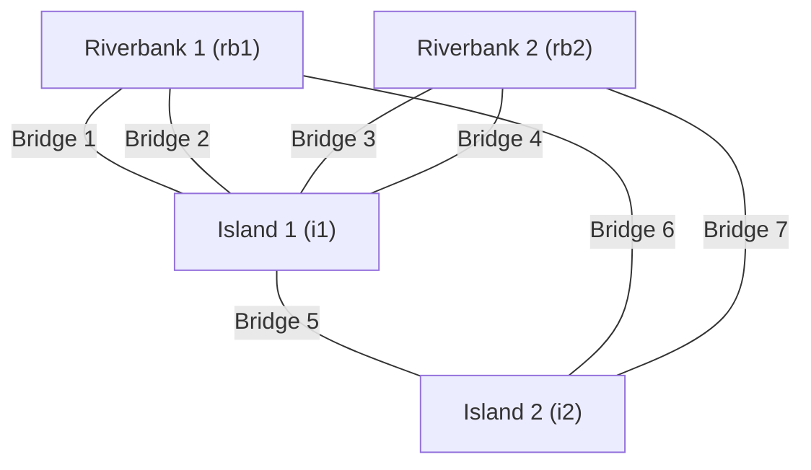
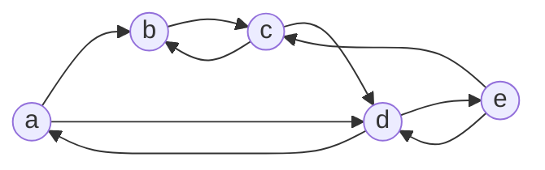

# Lecture 2: Problem Solving Using Search

---

## Executive Summary

This lecture explores **problem solving using search**, establishing how artificial intelligence agents formulate complex goals and navigate through state spaces to discover optimal action sequences.

### Core Takeaways

1. **Problem Formulation & Graph Representation:**
   * Grounded in graph theory pioneered by Leonhard Euler (Seven Bridges of Königsberg).
   * A problem space is mathematically formalized as a 4-tuple $[N, A, S, GD]$: States ($N$), Operators/Arcs ($A$), Start States ($S$), and Goal States ($GD$).
   * Environments are assumed to be static, discrete, observable, and deterministic.

2. **Search Architecture & Mechanics:**
   * A **search node** maintains five primary attributes: `[STATE, PARENT, ACTION, COST, DEPTH]`.
   * Unexpanded nodes form the **Fringe (`OPEN` list)**, managed as a queue whose priority discipline defines the search strategy.
   * Search performance is evaluated on **Completeness**, **Optimality**, **Time Complexity**, and **Space Complexity**, parameterized by branching factor $b$, goal depth $d$, and maximum tree depth $m$.

3. **Uninformed (Blind) Search Strategies:**
   * **Breadth-First Search (BFS):** FIFO queue; explores level-by-level; complete and cost-optimal (for uniform costs), but bounded by exponential memory demands ($O(b^d)$ time and space).
   * **Depth-First Search (DFS):** LIFO queue (Stack); explores deep branches with chronological backtracking; consumes minimal linear memory ($O(b \cdot m)$), but is neither complete nor optimal.
   * **Depth-Limited Search (DLS):** DFS bounded by a cutoff $k$; addresses infinite paths.
   * **Iterative Deepening Search (IDS / IDDFS):** Repeated DLS with increasing cutoffs ($k = 0, 1, 2, \dots$); achieves the best of both worlds—**optimality and completeness of BFS with the $O(b \cdot d)$ linear space of DFS**.
   * **Bidirectional Search:** Explores simultaneously from initial state and goal; drastically lowers complexity to $O(b^{d/2})$.

4. **Informed (Heuristic) Search Strategies:**
   * Exploits domain knowledge via a heuristic function $h(n)$ (estimated cost from node $n$ to goal).
   * **Greedy Best-First Search:** Selects nodes based strictly on $f(n) = h(n)$; computationally efficient but neither optimal nor complete.
   * **A\* Search:** Combines historical path cost and heuristic estimate: $f(n) = g(n) + h(n)$. Guaranteed to be **complete and optimal** provided $h(n)$ is **admissible** (never overestimates true cost).
   * **Iterative-Deepening A\* (IDA\*):** Adopts $f$-cost thresholds within a depth-first search framework; resolves A*'s exponential memory bottleneck, yielding optimal solutions in linear memory $O(b \cdot d)$.

---

## Table of Contents

- [Executive Summary](#executive-summary)
  - [Core Takeaways](#core-takeaways)
- [1. Problem-Solving Agent](#1-problem-solving-agent)
  - [Simple Agent Algorithm](#simple-agent-algorithm)
- [2. Foundations: Graph Theory & The City Bridge System](#2-foundations-graph-theory--the-city-bridge-system)
  - [The Königsberg Bridge Problem](#the-königsberg-bridge-problem)
- [3. Graph Definitions and Properties](#3-graph-definitions-and-properties)
  - [Example: Labeled Directed Graph](#example-labeled-directed-graph)
  - [Key Graph Terminology](#key-graph-terminology)
- [4. State Space Representation](#4-state-space-representation)
  - [The 4-Tuple Formalization: $[N, A, S, GD]$](#the-4-tuple-formalization-n-a-s-gd)
  - [Example 1: The 8-Puzzle Problem](#example-1-the-8-puzzle-problem)
  - [Example 2: Traveling Salesman Problem (TSP)](#example-2-traveling-salesman-problem-tsp)
- [5. Formulating the Search Problem](#5-formulating-the-search-problem)
  - [Assumptions in Basic Search](#assumptions-in-basic-search)
  - [Search Space Size](#search-space-size)
- [6. Basic Search Concepts & Search Tree Architecture](#6-basic-search-concepts--search-tree-architecture)
  - [Search Tree vs. State Space](#search-tree-vs-state-space)
  - [Search Node Data Structure](#search-node-data-structure)
  - [The Fringe (OPEN List)](#the-fringe-open-list)
  - [Evaluation Criteria for Search Strategies](#evaluation-criteria-for-search-strategies)
- [7. Uninformed (Blind) Search Strategies](#7-uninformed-blind-search-strategies)
  - [7.1 Breadth-First Search (BFS)](#71-breadth-first-search-bfs)
  - [7.2 Bidirectional Search](#72-bidirectional-search)
  - [7.3 Depth-First Search (DFS)](#73-depth-first-search-dfs)
  - [7.4 Depth-Limited Search (DLS)](#74-depth-limited-search-dls)
  - [7.5 Iterative Deepening Search (IDS / IDDFS)](#75-iterative-deepening-search-ids--iddfs)
  - [7.6 Summary Comparison of Uninformed Strategies](#76-summary-comparison-of-uninformed-strategies)
  - [7.7 Avoiding Repeated States](#77-avoiding-repeated-states)
- [8. Informed (Heuristic) Search Strategies](#8-informed-heuristic-search-strategies)
  - [The Heuristic Function: $h(n)$](#the-heuristic-function-hn)
  - [8.1 Greedy Best-First Search](#81-greedy-best-first-search)
  - [8.2 A* Search](#82-a-search)
  - [8.3 Iterative-Deepening A* (IDA*)](#83-iterative-deepening-a-ida)

---

## 1. Problem-Solving Agent

A **Problem-Solving Agent** is a goal-based agent that decides what to do by finding sequences of actions that lead to desirable states.

```
+-------------------------------------------------------+
|                        AGENT                          |
|                                                       |
|   Sensors ---> [ State Representation ]               |
|                       |                               |
|                       v                               |
|                [ Goal Selection ]                     |
|                       |                               |
|                       v                               |
|            [ Search for Solution Path ]               |
|                       |                               |
|                       v                               |
|   Actuators <-- [ Execute Plan / Actions ]            |
+-------------------------------------------------------+
                           ^
                           | (Percepts / Environment)
                           v
                    [ Environment ]
```

### Simple Agent Algorithm

```text
Algorithm: Problem-Solving-Agent
Inputs: Percepts from environment

1. initial-state  <- sense/read state
2. goal           <- select/read goal
3. successor      <- select/read action models
4. problem        <- (initial-state, goal, successor)
5. solution       <- search(problem)
6. perform(solution)
```

---

## 2. Foundations: Graph Theory & The City Bridge System

### The Königsberg Bridge Problem
Historically, graph theory began with the **Seven Bridges of Königsberg** problem:
* The city is divided by a river containing two islands.
* **Island 1** is connected by two bridges to both riverbanks and by one bridge to Island 2.
* **Island 2** has two bridges, each connecting to one riverbank.
* **Question:** Is there a walk around the city that crosses each bridge exactly once?
* **Solution:** Swiss mathematician **Leonhard Euler** (1736) invented graph theory by proving that such a walk is impossible because nodes with an odd number of connecting edges cannot support an Eulerian path.



---

## 3. Graph Definitions and Properties

A **graph** consists of:
1. **A set of nodes (vertices):** Can be finite or infinite.
2. **A set of arcs (edges):** Directed or undirected links connecting pairs of nodes. An arc is typically represented as an ordered pair: e.g., $(u, v)$.

### Example: Labeled Directed Graph



* **Nodes:** $V = \{a, b, c, d, e\}$
* **Arcs:** $E = \{(a, b), (a, d), (b, c), (c, b), (c, d), (d, a), (d, e), (e, c), (e, d)\}$

### Key Graph Terminology

* **Parent and Child:** If a directed arc connects node $N$ to $M$ ($N \to M$), $N$ is the **parent** and $M$ is the **child**.
* **Siblings:** If $N$ also connects to $K$ ($N \to K$), then $M$ and $K$ are **siblings**.
* **Rooted Tree:** A directed graph with a unique node (the **root**) that has no parents. All edges point away from the root, and every other node has exactly one parent.
* **Leaf (Tip) Node:** A node that has no children (sometimes called a *dead end*).
* **Path:** An ordered sequence of $n+1$ nodes $(v_0, v_1, \dots, v_n)$ such that $(v_i, v_{i+1})$ is an arc for all $0 \le i < n$. The length of this path is $n$.
  * *Example:* $[a, b, e]$ is a path of length 2.
* **Ancestor & Descendant:** On a path in a rooted graph, any predecessor node is an **ancestor**, and any successor node is a **descendant**.
* **Cycle (Loop):** A path that visits any node more than once.
* **Tree:** A connected graph with no cycles, meaning there is a unique simple path between every pair of nodes.
* **Connected:** Two nodes are connected if a path exists between them.

---

## 4. State Space Representation

According to Newell and Simon, a problem space consists of:
1. **State Space:** A set of states representing the possible configurations of the world.
2. **Set of Operators:** Actions that transition one state into another.

The problem space is naturally mapped onto a graph where **nodes = states** and **arcs = operators**.

### The 4-Tuple Formalization: $[N, A, S, GD]$

A state space search problem is formally defined by the tuple $[N, A, S, GD]$:
* **$N$:** Problem space (set of all reachable states).
* **$A$:** Set of arcs/links between nodes (operators/transitions).
* **$S \subseteq N$:** Non-empty set of **initial/start states**.
* **$GD \subseteq N$:** Non-empty set of **goal states**, described either by:
  1. A measurable property / condition of the state.
  2. A property of the developed path (a solution path leading from $S$ to $GD$).

---

### Example 1: The 8-Puzzle Problem

The 8-puzzle consists of a $3 \times 3$ board with 8 numbered tiles and 1 blank space.

$$\text{Initial State} = \begin{pmatrix} 1 & 4 & 3 \\ 7 & 6 & \_ \\ 5 & 8 & 2 \end{pmatrix} \quad \longrightarrow \quad \text{Goal State} = \begin{pmatrix} 1 & 2 & 3 \\ 4 & 5 & 6 \\ 7 & 8 & \_ \end{pmatrix}$$

* **States:** All possible arrangements of the 8 tiles and the blank space ($9! / 2 = 181,440$ reachable states).
* **Operators:** Move the blank space in four directions: $\{\text{Up}, \text{Down}, \text{Left}, \text{Right}\}$ (subject to boundary constraints).
* **Initial State:** A given starting configuration.
* **Goal State:** Target sorted configuration.
* **Path Cost:** Number of moves (each step cost = 1).
* *Note:* The final state alone is not enough; the solution is the **sequence of actions (path)** to reach it.

---

### Example 2: Traveling Salesman Problem (TSP)

A salesman must visit $n$ cities and return to the starting city, minimizing total travel distance.

* **State Space:** Sequences of visited cities.
* **Operators:** Traveling to an unvisited city.
* **Initial State:** Starting at the home city (e.g., $A$).
* **Goal State:** All cities visited once and returned to start.

#### Nearest Neighbor vs. Minimal Cost Solution
* **Nearest Neighbor (Greedy approach):** Always pick the nearest unvisited city.
  * Example Tour: $A \to E \to D \to B \to C \to A$ (Total Cost = **550**)
* **Optimal Minimal Cost Path:**
  * Example Tour: $A \to B \to C \to D \to E \to A$ (Total Cost = **375**)
* *Key Takeaway:* Greedy/local heuristics do not guarantee an optimal global solution.

---

## 5. Formulating the Search Problem

A standard search problem consists of 5 components:

1. **State Space:** Discrete, abstract representation of the world configuration.
2. **Initial State:** The state where the agent begins.
3. **Successor Function (Operators/Actions):**
   $$\text{Successor}: \text{State} \to \mathcal{P}(\text{State} \times \text{Action})$$
   Maps a given state to a set of valid (action, next-state) pairs.
4. **Goal Test:** A boolean test verifying if a given state satisfies the goal condition.
5. **Path Cost:** Function assigning a numeric cost to a path:
   $$\text{Path Cost}: \text{Path} \to \mathbb{R}^+$$
   Typically the sum of individual step costs (e.g., sum of edge weights or number of tile moves).

### Assumptions in Basic Search
* **Static:** The environment does not change while the agent is deciding.
* **Discrete:** States and actions are distinct and countable.
* **Observable:** The agent always knows its current exact state.
* **Deterministic:** Each action yields a single predictable outcome.

### Search Space Size
Search spaces in practical AI problems are vastly larger than can be fully enumerated.
* *Example:* Scheduling university courses so that every student across all majors can take their requested classes without conflict leads to combinatorial explosion. Real search algorithms explore only a tiny fraction of the state space.

---

## 6. Basic Search Concepts & Search Tree Architecture

### Search Tree vs. State Space
* **State Space:** The graph of all possible configurations of the problem.
* **Search Tree:** The tree representing paths explored from the initial state (the root). Multiple nodes in the tree may correspond to the exact same state in the state space.

### Search Node Data Structure
A search node is a data structure containing:
* `STATE`: The state in the state space corresponding to this node.
* `PARENT`: Pointer to the node that generated this node.
* `ACTION`: The action applied to the parent to reach this state.
* `COST` ($g$): The total path cost from the root to this node.
* `DEPTH` ($d$): The depth of this node in the tree (root depth = 0).

### The Fringe (OPEN List)
* **Fringe (OPEN):** The collection of leaf nodes currently available for expansion.
* Implemented as a queue supporting:
  * `INSERT(node, OPEN)`
  * `REMOVE(OPEN)`
* **Search Strategy:** The choice of which node to expand next is determined by the queuing discipline used for `OPEN`.

### Evaluation Criteria for Search Strategies
A search strategy is evaluated along four dimensions:
1. **Completeness:** Is the algorithm guaranteed to find a solution if one exists?
2. **Time Complexity:** How many nodes are generated/expanded during search?
3. **Space Complexity:** What is the maximum number of nodes stored in memory at once?
4. **Optimality:** Does the algorithm find the least-cost path among all possible solutions?

**Key Complexity Parameters:**
* $b$: Maximum **branching factor** of the search tree.
* $d$: Depth of the **shallowest goal node**.
* $m$: Maximum **depth of the state space** (can be $\infty$).

---

## 7. Uninformed (Blind) Search Strategies

Uninformed search strategies have no domain-specific knowledge about how close a state is to the goal. They only know how to generate successors and test for a goal.

### 7.1 Breadth-First Search (BFS)

BFS expands the shallowest unexpanded node first, moving level by level downward.

#### Algorithm (Queue / FIFO)
```text
Algorithm: Breadth-First Search
1. OPEN <- queue containing only the root path [initial_state]
2. WHILE OPEN is not empty AND goal is not reached:
3.     path <- REMOVE_FIRST(OPEN)
4.     node <- last node in path
5.     IF goal_test(node) == TRUE THEN RETURN path
6.     FOR each child of node:
7.         IF child does not cause a loop in path THEN
8.             new_path <- path + [child]
9.             ADD_TO_BACK(new_path, OPEN)   // FIFO queuing
10. RETURN Failure
```

#### Step-by-Step OPEN Trace Example
* **Step 1:** $\text{OPEN} = [1]$
* **Step 2:** Expand 1 $\to$ $\text{OPEN} = [2, 3]$
* **Step 3:** Expand 2 $\to$ $\text{OPEN} = [3, 4, 5]$
* **Step 4:** Expand 3 $\to$ $\text{OPEN} = [4, 5, 6, 7]$

#### Complexity & Properties
* **Completeness:** Yes (if branching factor $b$ is finite).
* **Optimality:** Yes, if step cost is identical (cost = 1 per step).
* **Time Complexity:**
  $$1 + b + b^2 + \dots + b^d = \frac{b^{d+1}-1}{b-1} = O(b^d)$$
* **Space Complexity:** $O(b^d)$ (all leaf nodes at level $d$ must reside in memory).

#### Time and Memory Requirements for BFS
*(Assumptions: $b = 10$, processing speed $= 1,000,000\text{ nodes/sec}$, memory $= 100\text{ bytes/node}$)*

| Depth ($d$) | Number of Nodes | Search Time | Memory Required |
|:-----------:|:---------------:|:-----------:|:---------------:|
| 2           | 111             | 0.01 ms     | 11 KB           |
| 4           | 11,111          | 1 ms        | 1 MB            |
| 6           | $\sim 10^6$     | 1 sec       | 100 MB          |
| 8           | $\sim 10^8$     | 100 sec     | 10 GB           |
| 10          | $\sim 10^{10}$  | 2.8 hours   | 1 TB            |
| 12          | $\sim 10^{12}$  | 11.6 days   | 100 TB          |
| 14          | $\sim 10^{14}$  | 3.2 years   | 10,000 TB       |

> **Conclusion:** BFS is primarily constrained by its **enormous memory requirements**, not just time.

---

### 7.2 Bidirectional Search

Runs two simultaneous searches:
1. Forward from the initial state (`OPEN1`).
2. Backward from the goal state (`OPEN2`).
The search stops when the two search frontiers intersect.

```text
Algorithm: Bidirectional Search
1. QUEUE1 <- queue with path [root]
2. QUEUE2 <- queue with path [goal]
3. WHILE QUEUE1 not empty AND QUEUE2 not empty:
4.     IF QUEUE1 and QUEUE2 share a common state THEN RETURN combined path
5.     Advance QUEUE1 by expanding its first path (add to back)
6.     Advance QUEUE2 by expanding its first path (add to back)
7. RETURN Failure
```

* **Complexity:**
  $$\text{Time and Space} = O(b^{d/2}) \ll O(b^d)$$
  *Example:* For $b=10$ and $d=8$, BFS explores $10^8$ nodes; bidirectional search explores $2 \times 10^4 = 20,000$ nodes.

---

### 7.3 Depth-First Search (DFS)

DFS always expands the deepest unexpanded node first, following a branch to its maximum depth before using **chronological backtracking** to explore alternative choices.

#### Algorithm (Stack / LIFO)
```text
Algorithm: Depth-First Search
1. OPEN <- stack containing only the root path [initial_state]
2. WHILE OPEN is not empty AND goal is not reached:
3.     path <- REMOVE_FIRST(OPEN)
4.     node <- last node in path
5.     IF goal_test(node) == TRUE THEN RETURN path
6.     FOR each child of node (left-to-right convention):
7.         IF child does not cause a loop in path THEN
8.             new_path <- path + [child]
9.             ADD_TO_FRONT(new_path, OPEN)  // LIFO queuing (Stack)
10. RETURN Failure
```

#### Step-by-Step OPEN Trace Example
* **Step 1:** $\text{OPEN} = [1]$
* **Step 2:** Expand 1 $\to$ $\text{OPEN} = [2, 3]$
* **Step 3:** Expand 2 $\to$ $\text{OPEN} = [4, 5, 3]$
* **Step 4:** Deepest path explored first until a dead end occurs, then backtracks to remaining branches.

#### Complexity & Properties
* **Completeness:** Incomplete in infinite-depth spaces or spaces with cycles (without cycle checking). Complete only for finite search trees.
* **Optimality:** Not optimal; it may return a long, expensive path before finding a shorter one.
* **Time Complexity:** $O(b^m)$ in the worst case (where $m$ is maximum depth).
* **Space Complexity:** Linear! Only the current path and unexplored siblings need to be stored:
  $$\text{Memory} = ((b - 1) \cdot d) + 1 = O(b \cdot m)$$
  *Example:* For $b = 3$ and $d = 3$, memory stores at most $((3 - 1) \times 3) + 1 = 7$ nodes.

---

### 7.4 Depth-Limited Search (DLS)

To solve the infinite-loop problem of DFS, DLS imposes a fixed depth cutoff $k$. Nodes at depth $k$ are treated as leaves without successors.

* **Three possible outcomes:**
  1. **Solution:** Goal found within depth $k$.
  2. **Failure:** Search exhausted; no solution exists in the entire tree.
  3. **Cutoff:** No solution found within limit $k$, but unexpanded nodes exist below $k$.

---

### 7.5 Iterative Deepening Search (IDS / IDDFS)

Iterative Deepening systematically finds the best depth limit by repeatedly executing Depth-Limited Search with increasing cutoffs: $k = 0, 1, 2, 3, \dots, d$.

```text
Algorithm: Iterative Deepening Search
FOR cutoff = 0, 1, 2, ... TO infinity:
    result <- Depth-Limited-Search(problem, cutoff)
    IF result != cutoff THEN RETURN result
```

#### Why Re-generating Nodes is Efficient
Although nodes near the top are regenerated repeatedly, the exponential growth of trees means the vast majority of nodes reside in the bottom level:

$$\text{Nodes generated} = (d+1)(1) + d \cdot b + (d-1) \cdot b^2 + \dots + 1 \cdot b^d = O(b^d)$$

#### Complexity & Properties
* **Completeness:** Complete (like BFS).
* **Optimality:** Optimal when step costs are uniform (like BFS).
* **Time Complexity:** $O(b^d)$.
* **Space Complexity:** $O(b \cdot d)$ (linear, like DFS).

> **Takeaway:** IDS combines the completeness and optimality of BFS with the linear memory efficiency of DFS.

---

### 7.6 Summary Comparison of Uninformed Strategies

| Strategy | Complete? | Optimal? | Time Complexity | Space Complexity |
|:---------|:---------:|:--------:|:---------------:|:----------------:|
| **Breadth-First (BFS)** | Yes | Yes (if cost=1) | $O(b^d)$ | $O(b^d)$ (Exponential) |
| **Depth-First (DFS)** | No (unless finite) | No | $O(b^m)$ | $O(b \cdot m)$ (Linear) |
| **Depth-Limited (DLS)** | No (if $k < d$) | No | $O(b^k)$ | $O(b \cdot k)$ (Linear) |
| **Iterative Deepening (IDS)** | Yes | Yes (if cost=1) | $O(b^d)$ | $O(b \cdot d)$ (Linear) |
| **Bidirectional Search** | Yes | Yes (if cost=1) | $O(b^{d/2})$ | $O(b^{d/2})$ |

---

### 7.7 Avoiding Repeated States

Searching a graph as a tree can cause infinite loops or exponential re-expansion of identical states.
* **Closed List (Explored Set):** Keep track of all generated states.
* **Rule:** If a newly generated state has already been expanded or exists in the Closed List, discard it immediately.

---

## 8. Informed (Heuristic) Search Strategies

Informed search uses domain-specific knowledge via a **heuristic function** $h(n)$ to guide the search toward the goal much faster.

### The Heuristic Function: $h(n)$
* **Definition:** $h(n) = \text{estimated cost of the cheapest path from node } n \text{ to a goal node}$.
* By definition, if $n$ is a goal node, $h(n) = 0$.
* *Example (15-Puzzle / 8-Puzzle):*
  * **Manhattan Distance:** The sum of horizontal and vertical distances of each tile from its goal position.
  * **Misplaced Tiles:** Number of tiles not currently in their goal spot.

---

### 8.1 Greedy Best-First Search

Greedy Best-First Search expands the node that appears closest to the goal based solely on the heuristic:

$$f(n) = h(n)$$

#### Algorithm
1. Initialize `OPEN` list with start node.
2. If `OPEN` is empty, return failure; otherwise, pick node with lowest $h(n)$.
3. If node is the goal, return success.
4. Move node to `Closed` list and add its unvisited children to `OPEN`.

#### Trace Example: Path from P to S
Suppose we seek a path from start node $P$ to goal node $S$:

1. **Step 1:** Expand $P \to$ Candidates: $A, C, R$.
   * $C$ has the lowest heuristic cost: $h(C) < h(A), h(R)$.
   * Select $C$. `Closed` = $\{P\}$.
2. **Step 2:** Expand $C \to$ Candidates: $M, R, U$.
   * Heuristic values: $M[9]$, $R[8]$, $U[4]$.
   * Select $U$ (cost = 4). `Closed` = $\{P, C\}$.
3. **Step 3:** Expand $U \to$ Candidates: $N, S$.
   * Heuristic values: $N[6]$, $S[0]$.
   * Select $S$ (cost = 0, Goal!). `Closed` = $\{P, C, U\}$.
* **Resulting Path:** $P \to C \to U \to S$.

| Node [cost $h(n)$] | Closed List |
|:------------------:|:-----------:|
| $M [9]$            | $P$         |
| $R [8]$            | $C$         |
| $U [4]$            | $C$         |
| $N [6]$            | $P, C$      |
| $S [0]$            | $P, C, U$   |

#### Properties
* **Minimizes immediate search effort**, but is **not optimal** (may follow a misleading short heuristic into a high-cost route).
* **Incomplete:** Can get trapped in infinite loops on graphs without cycle checking.

---

### 8.2 A* Search

A* evaluates nodes by combining the actual cost to reach the node $g(n)$ and the estimated cost to the goal $h(n)$:

$$f(n) = g(n) + h(n)$$

* $g(n)$: Exact path cost from start node to node $n$.
* $h(n)$: Estimated cost from $n$ to the goal.
* $f(n)$: Estimated total cost of the cheapest path passing through $n$ to the goal.

```
       g(n)                      h(n)
[Start] ----> [Current Node n] --------> [Goal]
|                                           |
+----------------- f(n) --------------------+
```

#### Strategy
Always expand the node in `OPEN` with the **lowest $f(n)$**.

#### Optimality of A* (Admissibility)
* **Admissible Heuristic (Optimistic):** A heuristic $h(n)$ is admissible if it never overestimates the true cost to reach the goal:
  $$h(n) \le h^*(n) \quad \text{for all } n$$
  *(where $h^*(n)$ is the true optimal cost from $n$ to goal).*
* **Theorem:** If $h(n)$ is admissible, tree-search A* is **guaranteed to find an optimal solution**.

#### Special Cases of A*
* If $h(n) = 0$ (constant), then $f(n) = g(n)$, and A* becomes **Uniform-Cost Search** (or BFS when all edge costs are equal).
* If $h(n) = h^*(n)$ (perfect heuristic), A* explores only the optimal path directly to the goal with zero search overhead.

---

### 8.3 Iterative-Deepening A* (IDA*)

#### The Problem with A*
While A* is complete and optimal, it keeps all generated nodes in memory, causing **exponential memory consumption** ($O(b^d)$), running out of RAM on large problems.

#### The IDA* Solution
IDA* combines the memory efficiency of depth-first search with the heuristic guidance of A*:
* Instead of depth cutoffs, it uses **$f$-cost thresholds**.
* Each iteration performs a depth-first search up to the current threshold.
* If no goal is found, the threshold for the next iteration is set to the **minimum $f$-value that exceeded the previous cutoff**.

#### Step-by-Step Procedure of IDA*
1. **Initialize:** Set root node as current node and compute its $f$-score: $f(\text{root}) = g(\text{root}) + h(\text{root})$.
2. **Set Threshold:** Threshold $\leftarrow f(\text{root})$.
3. **Depth-First Exploration:** Expand nodes using DFS. For each child, compute $f(\text{child})$.
4. **Pruning:** If $f(\text{child}) > \text{threshold}$, prune the branch and record $f(\text{child})$ as a candidate for the next threshold.
5. **Success:** If goal node is found, return the path.
6. **Update Threshold:** If goal is not found and search exhausts, increase threshold to the minimum pruned $f$-value, then repeat.

#### Iteration Trace Example
Given nodes with evaluation values, searching with expanding thresholds:
* **Iteration 1 ($\text{Threshold} = 4$):** Visited nodes: $\{5, 8, 7\}$ $\to$ all exceed threshold, pruned.
* **Iteration 2 ($\text{Threshold} = 5$):** Visited nodes: $\{7, 8, 6\}$ $\to$ pruned.
* **Iteration 3 ($\text{Threshold} = 6$):** Visited nodes: $\{7, 8, 9, 13\} \to$ pruned.
* **Iteration 4 ($\text{Threshold} = 7$):** Visited nodes: $\{8, 9, 12, 13, 14\} \to$ pruned.
* **Iteration 5 ($\text{Threshold} = 8$):** Visited nodes: $\{12, 14, 16, 15, 9, 13\} \to$ **Goal node $15$ found!**

#### Advantages of IDA*
* **Optimal and Complete** (with admissible heuristic).
* **Space Complexity:** Linear $O(b \cdot d)$ in terms of path length, completely resolving the memory bottleneck of standard A*.

