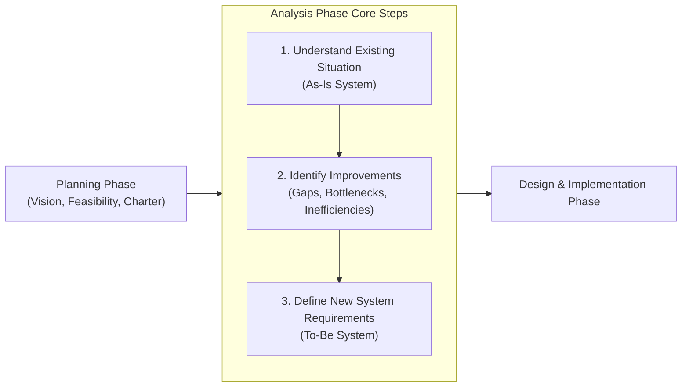
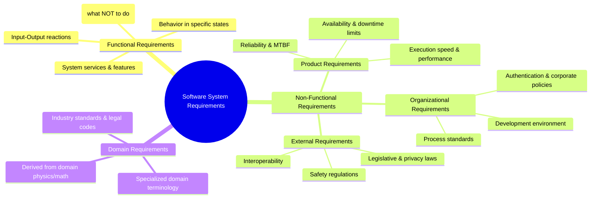

# Chapter 1: Fundamentals of Software Requirements Engineering

---

## Executive Summary

Chapter 1 introduces the core foundation, definitions, and classification taxonomies of Software Requirements Engineering (RE):
1. **Definition of Requirements Engineering (RE):** The disciplined process of discovering, analyzing, documenting, checking, and managing the services provided by a software system and its operational constraints.
2. **Analysis Phase in the SDLC:** Uses deliverables from the planning phase to understand business user needs through three foundational steps:
   - Understand the current baseline (**As-Is system**).
   - Identify pain points, bottlenecks, and **improvements**.
   - Define specifications for the target solution (**To-Be system**).
3. **What is a Requirement?** A specification of what a system must do (functions, behaviors, services) or what quality characteristics/constraints it must satisfy.
4. **The Four Requirement Levels:**
   - **User Requirements:** High-level natural language statements describing what tasks users need to accomplish.
   - **Functional Requirements:** Concrete technical statements of system services, inputs, behaviors, and explicit exclusions (what the system should *not* do).
   - **Non-Functional Requirements (NFRs):** System-wide constraints on behavior, architecture, development process, quality attributes, and regulatory compliance.
   - **System Requirements:** Detailed structural and technical documentation specifying how the system should be engineered.
5. **Quality Hallmarks of Requirements:** Specifications must aim for **Completeness** (all necessary capabilities are stated) and **Consistency** (no contradictory or conflicting statements). Imprecision and ambiguity cause severe developer-user interpretation gaps.
6. **Classification of Non-Functional Requirements (NFRs):**
   - **Product Requirements:** Behavioral and operational quality attributes (speed, memory, availability, reliability).
   - **Organizational Requirements:** Policies, internal corporate standards, implementation programming languages, and process methodologies.
   - **External Requirements:** Factors outside the organization's boundary (interoperability, safety regulations, privacy laws like HIPAA/GDPR).
7. **Domain Requirements:** Requirements originating directly from the application domain's fundamental nature, laws of physics, specialized mathematical formulas, or industry standards (e.g., Z39.50 library standard, copyright delete-on-print mandates, train deceleration physics equations).

---

## 1. What is Requirements Engineering (RE)?

Requirements reflect customer needs to solve real-world problems—such as controlling a physical device, placing commercial orders, managing medical patients, or querying information.



### The Three Analysis Steps:
- **Understand the As-Is System:** Study existing manual procedures, legacy software systems, and data flows to baseline current performance.
- **Identify Improvements:** Uncover pain points, redundancies, calculation errors, high costs, and missed business opportunities.
- **Define the To-Be System:** Document the exact services, workflows, and constraints needed in the replacement or upgraded solution.

---

## 2. Requirements Taxonomy & Levels

A requirement is a statement of what the system does or what characteristics it needs to exhibit. During a project, requirements are articulated across four complementary perspectives:

```
+-------------------------------------------------------------------------+
|                        REQUIREMENTS PERSPECTIVES                        |
|                                                                         |
|  +-------------------------+            +----------------------------+  |
|  |    User Requirements    |            |   Functional Requirements  |  |
|  | What users need to do   |            | What the software does     |  |
|  +-------------------------+            +----------------------------+  |
|               |                                       |                 |
|               v                                       v                 |
|  +-------------------------+            +----------------------------+  |
|  | Non-Functional Reqs     |            |    System Requirements     |  |
|  | System characteristics  |            | How the system is built    |  |
|  | & quality constraints   |            | & technical architecture   |  |
|  +-------------------------+            +----------------------------+  |
+-------------------------------------------------------------------------+
```

---

## 3. Core Software Requirements Classification

Software requirements are categorized into three primary classes:



---

## 4. Functional Requirements

Functional requirements describe the services and behavioral reactions of the software system.

### Key Characteristics:
- State what the system **shall do**.
- Describe system reactions to specific inputs and stimuli.
- Define behavior under boundary conditions or failure states.
- Can explicitly specify **what the system should NOT do** (negative constraints).
- Depend on:
  1. The type of software under development (e.g., embedded vs. enterprise vs. web).
  2. The target user base (novices, experts, automated systems).
  3. Organizational documentation standards.

### Real-World Examples:

#### Library Information System (LIBSYS)
- `FR-1:` The user shall be able to search either all initial database collections or select an arbitrary subset.
- `FR-2:` The system shall provide built-in document viewers allowing users to read retrieved materials directly in the document store.
- `FR-3:` Every order shall be allocated a unique alphanumeric `ORDER_ID`, which the user can copy to permanent account storage.

#### Medical Health Care – Patient Management System (MHC-PMS)
- `R-1:` A user shall be able to search appointment schedules across all hospital clinics.
- `R-2:` The system shall automatically generate a daily appointment manifest for each clinic every morning at 06:00.
- `R-3:` Each staff member operating the system shall be uniquely identified by an 8-digit healthcare authority employee badge number.

---

## 5. Specification Quality: Completeness, Consistency & Imprecision

Writing functional requirements requires balancing clarity, precision, and level of detail.

### 5.1 The Two Fundamental Quality Rules
- **Completeness:** All services, features, constraints, and exceptions required by users must be explicitly defined.
- **Consistency:** Requirements must not contradict each other or contain conflicting descriptions of system behavior.

### 5.2 The Hazard of Imprecision & Ambiguity
When requirements are written in ambiguous natural language, developers and users interpret terms differently:

> **Case Example:** "Search clinic appointments"
> - **User Intention:** Type a patient name once to search across *all* clinics simultaneously.
> - **Developer Interpretation:** User must select a single clinic dropdown first, then search within that clinic.
>
> *Result:* When delivered, the user is frustrated because finding a patient who booked at an unknown clinic requires 20 separate manual searches.

---

## 6. Non-Functional Requirements (NFRs)

Non-functional requirements represent **constraints on the services or functions** offered by the system.

### 6.1 Critical Attributes of NFRs
- Apply to the **system as a whole**, rather than individual discrete features.
- A failure in an NFR can render an entire system useless even if all functional requirements work correctly (e.g., an aircraft flight control system that executes accurate math but is 500ms too slow will crash the aircraft).
- NFRs heavily dictate the **overall software architecture** (e.g., microservices vs. monolithic, caching layers, network redundancy).
- A single NFR can generate multiple dependent functional requirements (e.g., a security NFR generates functional requirements for login screens, password hashing, encryption services, and audit logging).

### 6.2 Classification of Non-Functional Requirements

```
+-----------------------------------------------------------------------------------+
|                        NON-FUNCTIONAL REQUIREMENTS (NFRs)                         |
|                                                                                   |
|  +------------------------+  +------------------------+  +----------------------+ |
|  |  PRODUCT REQUIREMENTS  |  |   ORGANIZATIONAL REQS  |  |    EXTERNAL REQS     | |
|  | - Execution speed      |  | - Process standards    |  | - Interoperability   | |
|  | - Memory limits        |  | - Coding guidelines    |  | - Privacy laws (GDPR)| |
|  | - Reliability & MTBF   |  | - Health authority ID  |  | - Safety regulations | |
|  | - Uptime / Downtime    |  |   card authentication  |  | - Copyright laws     | |
|  +------------------------+  +------------------------+  +----------------------+ |
+-----------------------------------------------------------------------------------+
```

### 6.3 Real-World Comparative NFR Examples

| NFR Category | Medical Care System (MHC-PMS) | Library System (LIBSYS) |
| :--- | :--- | :--- |
| **Product Requirement** | System shall be available Mon–Fri, 08:30–17:30. Total downtime during working hours shall not exceed **5 seconds per day**. | The user interface shall be rendered as accessible, clean HTML without nested frames or Java applets. |
| **Organizational Requirement** | Clinic staff must authenticate using their physical health authority smart identity card. | Software development lifecycle and deliverables must strictly conform to internal corporate standard `XYZCo-SP-STAN-95`. |
| **External Requirement** | System must strictly enforce patient data confidentiality according to statutory healthcare privacy code `HStan-03-2006-priv`. | System shall not disclose personal patron records (beyond name and library card ID) to unauthorized staff. |

---

## 7. Domain Requirements

Domain requirements are derived from the **fundamental operational environment** of the application, rather than the specific desires of end users.

### Key Characteristics:
- Reflect fundamental domain concepts, technical standards, or scientific/mathematical laws.
- Can be **functional** (specifying a computation) or **non-functional** (constraining an interface).
- Often written using specialized industry jargon, making them difficult for generalist software engineers to interpret without subject matter expert (SME) assistance.
- If domain requirements are violated, the system cannot function in its intended physical or legal setting.

### Real-World Domain Examples:

#### 1. Standard Protocol Constraint (LIBSYS)
- *Requirement:* All search interfaces across external databases must conform strictly to the international **Z39.50 standard**.
- *Engineering Impact:* Developers cannot invent custom query APIs; they must study and implement the published library protocol.

#### 2. Legal / Copyright Domain Mandate (LIBSYS)
- *Requirement:* To comply with international digital copyright legislation, specific classes of imported licensed documents must be **automatically deleted on arrival or printed directly to a network server with no local electronic copy saved**.
- *Engineering Impact:* Requires a specialized automatic delete-on-print background daemon.

#### 3. Physics & Safety Formula (Train Protection System)
- *Requirement:* The automatic braking deceleration of the train shall be computed as:
  $$D_{\text{train}} = D_{\text{control}} + D_{\text{gradient}}$$
  where $D_{\text{gradient}}$ is calculated using:
  $$D_{\text{gradient}} = 9.81\ \text{m/s}^2 + \frac{\text{compensated gradient}}{\alpha}$$
  and the calibrated values of $\frac{9.81\ \text{m/s}^2}{\alpha}$ are determined dynamically based on the specific train class.
- *Engineering Impact:* Developers must implement safety-critical mathematical calculations certified against track physics and inertia dynamics.

