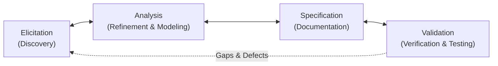
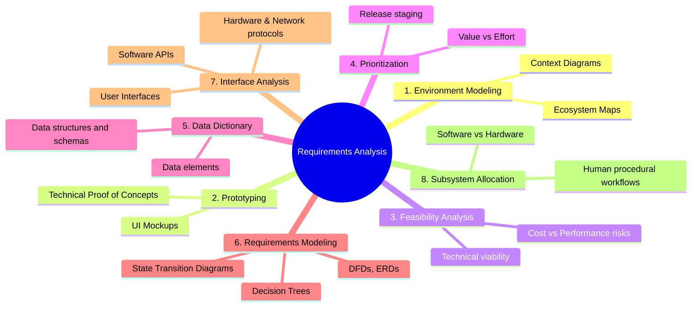
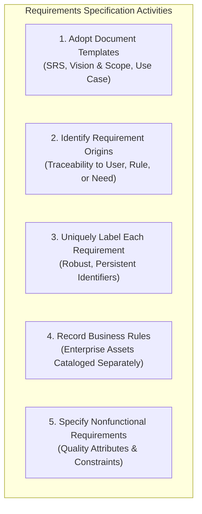

# Chapter 2: Requirements Analysis & Specification

---

## Executive Summary

Chapter 2 covers the second and third subdisciplines of Requirements Development: **Requirements Analysis** (transforming raw elicited statements into refined, verified, and modeled requirements) and **Requirements Specification** (authoring structured, unambiguous, and traceable requirements documentation).

### Key Takeaways:
1. **Requirements Development Lifecycle:** Elicitation, Analysis, Specification, and Validation do not execute as a rigid, one-pass waterfall sequence. Rather, **Requirements Development is inherently iterative**—eliciting information triggers preliminary analysis, which leads to modeling and partial specification, revealing new gaps that prompt further elicitation.
2. **Requirements Analysis Objectives:**
   - Detect and resolve conflicts, overlaps, ambiguities, and omissions in elicited needs.
   - Decompose high-level user statements into detailed functional and nonfunctional requirements.
   - Model the application environment visually to uncover missing logic.
   - Prioritize requirements for iterative release planning.
3. **Core Analysis Activities (8 Disciplines):**
   1. *Model Application Environment:* Establish boundaries with context diagrams and ecosystem maps.
   2. *Create Prototypes:* Build UI wireframes and technical proof-of-concepts to validate feasibility.
   3. *Analyze Requirement Feasibility:* Evaluate cost, technical obstacles, and performance trade-offs.
   4. *Prioritize Requirements:* Analytical scoring (value, cost, risk) for release planning.
   5. *Create Data Dictionary:* Define precise data structures, formats, and semantic definitions.
   6. *Model Requirements:* Utilize diagrams (DFD, ERD, State Transition, Decision Trees).
   7. *Analyze External Interfaces:* Specify software, hardware, user, and communication interfaces.
   8. *Allocate Requirements to Subsystems:* Apportion responsibilities across software, hardware, and people.
4. **Core Specification Activities (5 Disciplines):**
   1. *Adopt Standard Templates:* Standardize structure using SRS, Vision & Scope, and Use Case templates.
   2. *Identify Requirement Origins:* Maintain upstream traceability to customers, use cases, or business rules.
   3. *Uniquely Label Each Requirement:* Robust alphanumeric naming conventions for unambiguous referencing.
   4. *Record Business Rules Separately:* Treat business policies and algorithms as enterprise-level assets.
   5. *Specify Nonfunctional Requirements (NFRs):* Document quality attributes (performance, reliability, usability, security) and operational constraints.
5. **Cross-Cutting Best Practices:**
   - *Change Management:* Change Control Board (CCB), impact analysis, baseline versioning.
   - *Traceability:* Requirements Traceability Matrix (RTM) linking business objectives $\rightarrow$ user requirements $\rightarrow$ functional specs $\rightarrow$ test cases.
   - *Project Management Alignment:* Life cycle selection, effort estimation, and risk management.

---

## 1. The Iterative Nature of Requirements Development

Requirements development is not a one-way conveyor belt:
- As you model requirements during **Analysis**, you uncover logical inconsistencies and gaps that require more **Elicitation**.
- As you write precise descriptions in **Specification**, you detect ambiguities that force deeper **Analysis**.
- Reviewing test cases during **Validation** uncovers missing requirements, restarting the cycle.

---

## 2. Requirements Analysis Activities

Requirements Analysis refines raw user input into a coherent, structured, and feasible set of system requirements.

### Detailed Breakdown of the 8 Analysis Activities

#### 1. Model the Application Environment
- **Purpose:** Clarifies how the new system fits into the broader enterprise and operational world.
- **Context Diagram:** Establishes system boundaries and external interfaces to terminators (users, external systems, hardware devices).
- **Ecosystem Map:** Shows all participating applications that consume, transform, or supply data to your product, mapping interdependencies.

#### 2. Create User Interface and Technical Prototypes
- **Purpose:** Constructs preliminary implementations to make concepts tangible when users cannot articulate what they want.
- **Benefits:** Helps users validate assumptions early; clarifies ambiguous expectations; tests novel technology stacks.

#### 3. Analyze Requirement Feasibility
- **Purpose:** Evaluates whether each requirement can be implemented with acceptable cost, technical risk, and performance.
- **Mechanism:** Business Analysts partner with software architects and developers to identify dependencies, technical bottlenecks, and integration risks. Unfeasible or cost-prohibitive requirements are simplified while preserving business intent.

#### 4. Prioritize Requirements
- **Purpose:** Ensures the development team delivers maximum business value early and manages scope within budget/time constraints.
- **Technique:** Apply an analytical framework (e.g., balancing business value, implementation cost, and technical risk) to assign features to specific development increments or releases. Priorities are adjusted as market dynamics change.

#### 5. Create a Data Dictionary
- **Purpose:** Central repository containing precise, unambiguous definitions of all data items, structures, schemas, and values used throughout the system.
- **Benefit:** Ensures domain consistency across developers, testers, analysts, and business stakeholders, eliminating semantic misunderstandings.

#### 6. Model the Requirements
- **Purpose:** Visual diagrams complement textual descriptions to expose contradictions, redundancies, gaps, and unnecessary features.
- **Standard Analysis Models:**
  - *Data Flow Diagrams (DFDs):* Flow and transformation of information through processes.
  - *Entity-Relationship Diagrams (ERDs):* Data entity structures, attributes, and relationships.
  - *State-Transition Diagrams & State Tables:* System behavior in response to events across different operational states.
  - *Dialog Maps:* User interface navigation architecture.
  - *Decision Trees & Tables:* Complex conditional business logic and nested rules.

#### 7. Analyze Interfaces Between Your System and the Outside World
- **External Interfaces:**
  - *User Interfaces (UI):* Interactions between human operators and the system.
  - *Software Interfaces (APIs/Services):* Data exchange contracts with internal/external systems.
  - *Hardware Interfaces:* Direct sensor, actuator, or device interconnections (vital for embedded systems).
  - *Communication Interfaces:* Network protocols, bandwidth, encryption, and messaging formats.

#### 8. Allocate Requirements to Subsystems
- **Purpose:** In complex systems comprising multiple subcomponents, requirements must be apportioned among software, hardware, and human operator roles.
- *Example:* A secure building access control system:
  - *Hardware:* Optical badge readers, biometric scanners, electromagnetic door locks, CCTV cameras.
  - *Software:* Badge validation database, logging engine, real-time alert dispatch.
  - *Human:* Security guards managing visitor exceptions and monitoring alarm consoles.

---

## 3. Requirements Specification Activities

Requirements Specification formalizes user needs into structured, actionable, and testable requirements deliverables (such as the Software Requirements Specification - SRS).

### Detailed Breakdown of the 5 Specification Activities

#### 1. Adopt Requirement Document Templates
- Standardized templates (e.g., IEEE 830 / ISO 29148 SRS templates, use case templates, vision and scope documents) enforce organizational consistency.
- Acts as a comprehensive checklist ensuring analysts do not forget critical information types (such as security, internationalization, or constraints).

#### 2. Identify Requirement Origins
- Every functional requirement must trace back to its origin (a specific stakeholder interview, use case, business objective, regulation, or business rule).
- Knowing the origin identifies the exact stakeholders to consult when changes are proposed or trade-offs must be evaluated.

#### 3. Uniquely Label Each Requirement
- Each requirement must receive a persistent, unique identifier (e.g., `REQ-CHEM-ORDER-042`).
- The numbering convention must withstand deletions, modifications, and insertions over time without renumbering existing requirements.
- Enables precise bidirectional traceability and configuration tracking.

#### 4. Record Business Rules Separately
- **What are Business Rules?** Corporate policies, statutory regulations, tax codes, mathematical algorithms, and operational standards.
- **Enterprise Asset Rule:** Business rules exist independent of any individual project and must be cataloged in an enterprise repository.
- Many functional requirements exist solely to enforce a business rule; maintaining traceability links between rules and functional requirements guarantees compliance when policies evolve.

#### 5. Specify Nonfunctional Requirements (NFRs)
- Systems can deliver 100% of functional requirements and still fail commercially if quality expectations are not met.
- **Key Quality Attributes:**
  - *Performance:* Response latency, throughput, concurrency capacity.
  - *Reliability & Availability:* Mean time between failures (MTBF), uptime percentages.
  - *Security:* Authentication, role-based authorization, encryption in transit and at rest.
  - *Usability & Accessibility:* User learning curve, error rate, compliance with accessibility standards (e.g., WCAG).
  - *Modifiability & Maintainability:* Ease of enhancement and refactoring.
- Also encompasses external interface specifications, technical constraints, operating environments, and internationalization/localization.

---

## 4. Cross-Cutting Best Practices Matrix

A mature Requirements Engineering process requires supporting practices categorized across three operational dimensions:

| Category | Best Practice | Key Objective & Operational Value |
| :--- | :--- | :--- |
| **Requirements Management** | Establish a Change Control Process | Formal Change Control Board (CCB) reviews and approves/rejects proposed changes |
| | Perform Change Impact Analysis | Evaluates schedule, cost, technical, and quality impacts before approving changes |
| | Establish Baselines & Version Control | Freezes approved requirements sets; tracks delta changes over iterations |
| | Maintain Traceability Matrix (RTM) | Links business needs $\rightarrow$ user requirements $\rightarrow$ functional specs $\rightarrow$ test cases |
| | Track Status & Issues | Tracks each requirement through defined states (Proposed, Approved, Implemented, Verified) |
| **Knowledge & Skill** | Train Business Analysts | Equips BAs with elicitation, modeling, and communication competencies |
| | Educate Stakeholders & Developers | Bridges communication barriers between technical architects and business leaders |
| | Define Standard RE Process | Establishes uniform terminology, deliverables, and quality gates across projects |
| | Create a Project Glossary | Eliminates jargon and acronym confusion across multidisciplinary teams |
| **Project Management** | Align with Software Life Cycle | Adapts requirements practices for Agile, Waterfall, or Hybrid frameworks |
| | Estimate Requirements Effort | Budgets appropriate BA time and resources early in project planning |
| | Manage Requirements Risks | Identifies high-risk, volatile, or unfeasible requirements before implementation |
| | Review Lessons Learned | Archives retrospective insights to continuously improve future engineering cycles |
