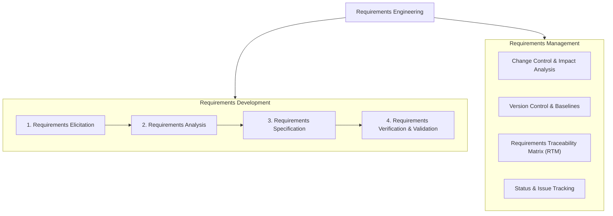
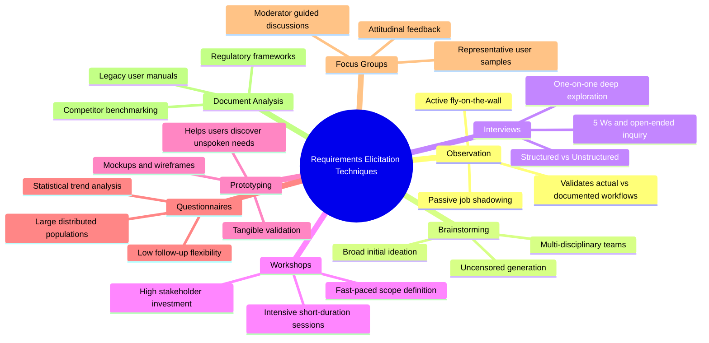

# Chapter 2: Requirements Elicitation

---

## Executive Summary

Chapter 2 covers the first and foundational subdiscipline of Requirements Engineering: **Requirements Elicitation** (discovering and uncovering user and business needs).

### Key Takeaways:
1. **Requirements Engineering Structure:** Divided into two main areas:
   - **Requirements Development:** Elicitation $\rightarrow$ Analysis $\rightarrow$ Specification $\rightarrow$ Validation & Verification.
   - **Requirements Management:** Change control, version control, status tracking, issue tracking, and requirements traceability.
2. **What is Requirements Elicitation?** The process of identifying business needs, project scope, assumptions, and risks through deep collaboration with stakeholders. Catching requirements issues early dramatically lowers project costs, prevents catastrophic failures, and ensures delivered software matches true user desires.
3. **Core Elements of Business Requirements:**
   - **Business Problems & Opportunities:** What pain points or opportunities motivate the system.
   - **Business Objectives:** Quantifiable targets (e.g., reduce chemical costs by 25% within 1 year).
   - **Success Metrics:** Measurable indicators tracked during testing or post-release (e.g., order time under 10 minutes for 80% of orders).
   - **Vision Statement:** A standardized, structured statement defining target customers, core capabilities, primary business benefits, and differentiators compared to existing solutions.
4. **Scope Representation Techniques:**
   - **Context Diagram:** Top-level data flow diagram showing external entities (terminators) and data/control flows across the boundary.
   - **Ecosystem Map:** Visualizes all participating systems that exchange data or are affected, including systems without direct interfaces.
   - **Feature Tree:** Hierarchical breakdown (L1, L2, L3) grouping features into visual logical branches; ideal for executive overviews.
   - **Event List:** Exhaustive catalog of triggers (business events by users, temporal/time-triggered events, signal events from hardware).
5. **Stakeholder Identification:** Segmenting into **Primary** (direct daily users), **Secondary** (indirectly affected), and **Key** (decision-makers/sponsors).
6. **Core Elicitation Techniques:**
   - **Observation:** Watching users in their real environment to uncover tacit knowledge.
   - **Brainstorming:** Broad, uncensored ideation across diverse stakeholder representatives.
   - **Interviews:** In-depth one-on-one discovery; leverages the 5 Ws (Who, What, When, Where, Why) and open-ended questions.
   - **Requirements Workshops:** Fast-paced, collaborative sessions hammering out requirements with key stakeholders over intensive days.
   - **Prototyping:** Making preliminary concepts tangible; essential because users often don't know what they want until they see what they don't want.
   - **Surveys / Questionnaires:** Reaching large, geographically dispersed populations (weak at follow-up clarifications).
   - **Focus Groups:** Exploring perceptions and attitudes of representative user segments.
   - **Document / Interface Analysis:** Studying legacy user manuals, competition, regulatory standards, and existing system contracts.

---

## 1. Requirements Engineering Process & Subdisciplines

Requirements Engineering encompasses all activities associated with discovering, evaluating, documenting, consolidating, and managing requirements throughout the software life cycle.



### Key Differences between Subdisciplines:
- **Requirements Development:** Focuses on creating, refining, modeling, and verifying the baseline requirements set.
- **Requirements Management:** Focuses on maintaining integrity, controlling modifications, tracking implementation progress, and managing dependencies once requirements are defined.

---

## 2. What is Requirements Elicitation?

Requirements Elicitation is the proactive exploration and discovery of requirements from stakeholders, documentation, and operational environments.

### Why is Elicitation Imperative?
- Unearths the real, underlying business needs, not just perceived or surface-level desires.
- Prevents expensive rework and catastrophic project failure caused by incomplete or incorrect requirements.
- Builds consensus, alignment, and shared ownership among diverse stakeholder groups early in the life cycle.

### Key Elicitation Objectives:
1. Identify product business goals, financial opportunities, and organizational objectives.
2. Characterize user classes, customer segments, and indirect stakeholders.
3. Elicit both functional requirements (what the system does) and nonfunctional quality attributes (performance, security, usability).
4. Discover operational environment constraints and system integrations.

---

## 3. Defining Business Requirements, Objectives & Success Metrics

```
+------------------------------------------------------------------------+
|                          Business Requirements                         |
|  +---------------------+   +---------------------+   +---------------+ |
|  | Business Problem /  |-->| Business Objective  |-->| Success Metric| |
|  | Opportunity         |   | (Strategic Target)  |   | (Measurement) | |
|  +---------------------+   +---------------------+   +---------------+ |
+------------------------------------------------------------------------+
```

### 3.1 Business Problems vs. Business Objectives
- **Business Problem:** The operational pain point or market barrier currently experienced by the organization.
  - *Example:* "Managing chemical inventories manually costs too much and results in discarded, expired inventory."
- **Business Objective:** A clear, quantifiable goal the organization aims to achieve by deploying the system.
  - *Example:* "Reduce chemical purchasing expenses by 25% within the first year of operation."

### 3.2 Success Metrics
Success metrics are concrete, measurable indicators used to determine whether the product is successfully delivering its business objectives during testing or post-release.
- *Example:* "Reduce average time spent ordering chemicals to 10 minutes or less on 80% of orders."

### 3.3 The Vision Statement Format
A standard template capturing the high-level scope and value proposition:

> **For** [target customer / user class]  
> **Who** [statement of the need or opportunity]  
> **The** [product name] **is a** [product category]  
> **That** [major capabilities, key benefit, compelling reason to buy / use]  
> **Unlike** [primary competitive alternative or current manual process]  
> **Our product** [statement of primary differentiation and unique business value]  

#### Chemical Tracking System Vision Statement Example:
- **For** scientists who need to request containers of chemicals,
- **The Chemical Tracking System is** an information system
- **That** will provide a single point of access to the chemical stockroom and to vendors, storing the location of every chemical container, quantity remaining, and complete usage history. It will save 25% on chemical costs in the first year.
- **Unlike** current manual ordering processes,
- **Our product** will automatically generate all federal and state government compliance reports for chemical storage and hazardous disposal.

---

## 4. Scope Representation Techniques

Clear scope boundaries prevent **scope creep** (uncontrolled expansion of requirements) and align developer expectations with executive intent.

| Scope Technique | Primary Purpose | Key Visual / Structural Elements | Ideal Audience |
| :--- | :--- | :--- | :--- |
| **Context Diagram** | Defines system boundary and external interfaces | External entities (terminators), system bubble, and data/control flows | Technical leads, architects, analysts |
| **Ecosystem Map** | Shows all participating systems in the enterprise solution space | Direct and indirect systems, data feeds, external databases, compliance hubs | System architects, enterprise IT managers |
| **Feature Tree** | Concise hierarchical visual overview of product features | 3 levels of logical feature branches (L1, L2, L3) | Executives, sponsors, product managers |
| **Event List** | Names all possible external triggers that evoke system behavior | Catalog of business events, temporal/time triggers, hardware signals | Developers, test engineers, analysts |

### Detailed Scope Models

#### A. Context Diagram
A top-level data flow diagram (DFD Level 0) where the entire system is represented as a single central process connected to external entities.
- **Terminators (External Entities):** Chemist, Buyer, Chemical Stockroom, Health & Safety Department, Barcode Scanner, Training Database.
- **Data Flows:** Chemical requests, vendor catalog queries, container barcode scans, inventory reports, hazardous training records.

#### B. Ecosystem Map
Differs from the context diagram by illustrating the broader interconnected landscape of applications, including systems that do not interface directly with the new product but consume or supply its data through intermediaries.

#### C. Feature Tree
Decomposes high-level functional areas into sub-features:
- **L1 Feature Group:** Order Chemicals
  - **L2 Sub-Feature:** Preferred Vendors
    - **L3 Detailed Feature:** Catalog Search, Local Lab Search, Direct Vendor Inquiry
- **L1 Feature Group:** Health & Safety
  - **L2 Sub-Feature:** Compliance Reporting (OSHA, EPA)
- **L1 Feature Group:** Inventory Management
  - **L2 Sub-Feature:** Bar Code Scanning, Auto-Reordering

#### D. Event List
Catalogs the three categories of events:
1. **User / Business Events:** Initiated by human action (e.g., *"Chemist places a chemical request"*).
2. **Temporal Events:** Triggered by time/date thresholds (e.g., *"Time to generate quarterly EPA report arrives"*).
3. **Signal Events:** Received from hardware sensors or external feeds (e.g., *"Chemical container barcode is scanned"*).

---

## 5. Identifying Stakeholders

Stakeholders are individuals, groups, or organizations that can affect, be affected by, or perceive themselves to be affected by the software project.

```
+-------------------------------------------------------------------------+
|                              STAKEHOLDERS                               |
|                                                                         |
|  +--------------------+  +----------------------+  +------------------+ |
|  |    PRIMARY         |  |     SECONDARY        |  |      KEY         | |
|  | Direct end-users   |  | Indirectly affected  |  | Decision-makers, | |
|  | hands-on with the  |  | by inputs, outputs,  |  | project sponsors,| |
|  | system daily       |  | or integrations      |  | executive funders| |
|  | (e.g., Chemists,   |  | (e.g., IT auditors,  |  | (e.g., VP of R&D,| |
|  | Stockroom clerks)  |  | Regulatory bodies)   |  | Chief Chemist)   | |
|  +--------------------+  +----------------------+  +------------------+ |
+-------------------------------------------------------------------------+
```

---

## 6. Comprehensive Requirements Elicitation Techniques

A skilled Business Analyst acts like a detective—combining multiple elicitation techniques to uncover conscious, unconscious, and unspoken requirements.



### Comparative Evaluation of Elicitation Techniques

| Technique | When to Use | Major Benefits | Key Limitations & Constraints |
| :--- | :--- | :--- | :--- |
| **Observation** | To capture existing real-world workflows and legacy processes | Captures tacit knowledge and unspoken workarounds that users forget to mention | Hawthorne effect (users alter behavior when watched); time-consuming |
| **Brainstorming** | At early project initiation to explore broad innovative possibilities | Rapid generation of creative ideas; fosters stakeholder ownership | Risk of digression; requires skilled moderation to prevent dominant personalities from taking over |
| **Interviews** | In-depth exploration of specific role needs and specialized domain logic | Builds trust; allows deep drill-down via the 5 Ws; uncovers real root causes | Highly dependent on interviewer skill; time-consuming to schedule and synthesize |
| **Requirements Workshops** | When project schedule is tight and cross-departmental consensus is needed | Rapid alignment; breaks departmental silos; gets scope locked in days | High coordination effort; expensive; failure if key decision-makers are absent |
| **Prototyping** | Novel concepts, complex user interfaces, or ambiguous requirements | Tangible feedback; users realize what they do *not* want; validates workflows early | Users may mistake prototype for finished software; potential scope creep |
| **Surveys / Questionnaires** | Large, geographically dispersed user populations across time zones | Inexpensive; gathers quantitative data across hundreds of users quickly | Cannot ask interactive follow-up questions; low response rates; ambiguous questions cannot be clarified |
| **Focus Groups** | To gauge subjective attitudes, perceptions, and customer feedback | Uncovers qualitative user sentiments and competitive preferences | Groupthink; vocal participants may bias the sample; may not represent all user types |
| **Document & Interface Analysis** | When replacing legacy systems or operating in regulated industries | Independent discovery; unearths corporate rules, data structures, and compliance mandates | Existing documentation is frequently obsolete, inaccurate, or incomplete |

