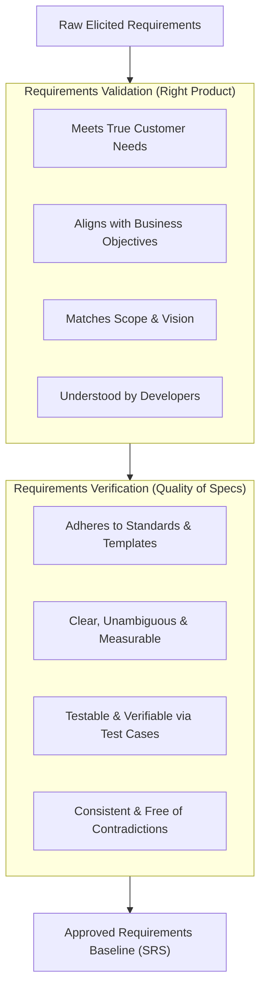
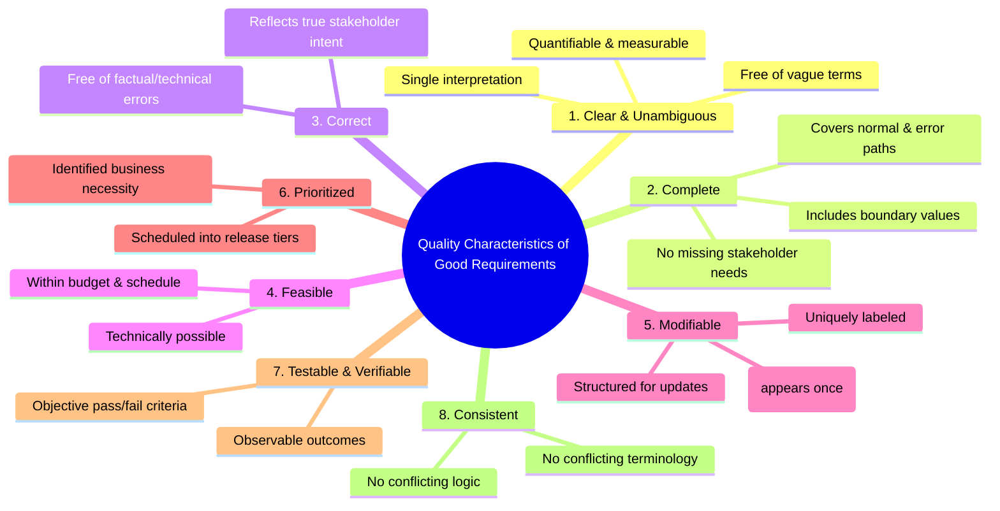
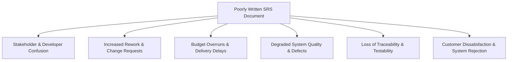

# Chapter 3: Requirements Validation & Verification (Part 1)

---

## Executive Summary

Chapter 3 explores the crucial quality assurance processes of Requirements Engineering: **Requirements Validation and Verification (V&V)**. It details the essential quality characteristics that individual requirements and specifications must possess, and examines the severe risks of a poorly written Software Requirements Specification (SRS).

### Key Takeaways:
1. **Validation vs. Verification:**
   - **Validation ("Building the right product"):** Confirms that requirements accurately reflect customer and user needs, business goals, and system boundaries. Focuses on correctness and completeness.
   - **Verification ("Building the product right"):** Confirms that requirements meet formal quality criteria, follow organizational standards, and can be tested, measured, and traced.
2. **Quality Characteristics of Good Requirements:**
   - **Clear & Unambiguous:** Exactly one interpretation; measurable and quantifiable; avoids subjective adjectives like "user-friendly" or "scalable".
   - **Complete:** "Not more, not less." Specifies all required functional cases, boundary conditions, error handling, and inputs. Incomplete requirements cause an estimated 12.3% of project failures and major budget overruns.
   - **Correct:** Every requirement accurately represents an authorized capability requested by stakeholders or derived from legitimate business rules.
   - **Feasible:** Technically executable within existing constraints, schedule, budget, technology capabilities, and environmental limitations.
   - **Modifiable:** Uniquely labeled, appears only once (atomic/non-redundant), organized logically to facilitate future changes.
   - **Necessary & Prioritized:** Traceable to real business value; prioritized into delivery increments.
   - **Testable / Verifiable:** Pass/fail test cases can be designed to objectively prove the delivered software satisfies the statement.
   - **Consistent:** Free of internal or cross-specification contradictions.
3. **The High Cost of Poorly Written SRS Documents:**
   - Communication breakdown and confusion between developers and business users.
   - Massive, expensive downstream rework during testing or post-deployment.
   - Budget underestimation and schedule slippage.
   - Loss of bidirectional traceability and compromised product quality.

---

## 1. Requirements Validation & Verification Overview

### Objectives of Validation:
- Identify missing, extraneous, or incorrect requirements.
- Ensure individual requirements and the overall set satisfy formal quality standards.
- Bridge the understanding gap between business stakeholders and technical implementers.

---

## 2. Nine Essential Quality Characteristics of Requirements

For an individual requirement or an entire SRS to be of high quality, it must satisfy the following core characteristics:

---

### Detailed Analysis of Quality Characteristics

| Quality Characteristic | Definition & Significance | Real-World Examples & Contrast |
| :--- | :--- | :--- |
| **1. Clear & Unambiguous** | Leaves no room for subjective interpretation; exactly one meaning shared by business users and developers. Quantifiable metrics replace vague words. | ❌ *Ambiguous:* "The system shall be easy to use and fast." ✅ *Unambiguous:* "A trained clerk shall complete customer checkout in under 90 seconds on 95% of transactions." |
| **2. Complete** | Specifies all functional capabilities, user inputs, outputs, environmental states, error responses, and boundary conditions ("no more, no less"). | ❌ *Incomplete:* "The system shall calculate sales tax." (Missing tax rates, regional exemptions, and rules). ✅ *Complete:* "The system shall calculate state and county sales tax based on the shipping address zip code using the current State Tax Table (Table 4.1)." |
| **3. Correct** | Accurately states a capability truly needed by the user or required by law/policy, verified through stakeholder sign-off and review. | ❌ *Incorrect:* Specifying interest compounded monthly when banking regulations legally require daily compounding. ✅ *Correct:* Formula aligned with official regulatory statutes. |
| **4. Feasible** | Capable of being implemented within system constraints, technological limits, team competencies, allocated budget, and schedule. | ❌ *Infeasible:* "The system shall translate spoken audio in real-time with 100% accuracy in noisy industrial environments on low-power IoT microcontrollers." ✅ *Feasible:* "The system shall recognize 50 pre-defined voice commands with $\ge$95% accuracy in quiet environments." |
| **5. Modifiable** | Can be modified easily and reliably when changes occur; requires a logical table of contents, unique numbering/labeling, and no redundancy (each requirement appears only once). | ❌ *Unmodifiable:* The same session timeout rule is copy-pasted across 12 different sections. ✅ *Modifiable:* Requirement `NFR-SEC-014` defines session timeout; all other sections cross-reference `NFR-SEC-014`. |
| **6. Necessary & Prioritized** | Every requirement must originate from an authorized business need, rule, or user objective. Prioritizing ensures maximum value is delivered first. | ❌ *Unprioritized:* 200 requirements presented with equal urgency. ✅ *Prioritized:* Categorized into High (Sprint 1), Medium (Sprint 3), Low (Future releases). |
| **7. Testable / Verifiable** | Finite, cost-effective test cases (inspection, unit tests, automated integration tests) can definitively demonstrate that the software satisfies the requirement. | ❌ *Untestable:* "The report must be visually appealing and modern." ✅ *Testable:* "The report must display sales totals grouped by product category in tabular format conforming to corporate UI Style Guide v2.1." |
| **8. Consistent** | Individual requirements do not conflict with or contradict other requirements, business rules, or external standards. | ❌ *Inconsistent:* Section 3.1 states "Email address is mandatory for registration," while Section 4.5 states "Users may register using only a phone number." ✅ *Consistent:* Unified registration rules enforced across all sections. |

---

## 3. Deep Dive: The Criticality of Completeness

A lack of validation leads to incomplete requirements that fail to capture vital stakeholder needs.

### 3.1 Seven Interpretations of "Requirements Completeness"
1. **Completeness of Requirements Analysis Models:** Diagrams (DFDs, ERDs, State models) depict all states and transitions.
2. **Completeness of Individual Requirements:** Each requirement includes inputs, calculations, expected outputs, and error handling.
3. **Completeness of Requirement Metadata:** Attributes like priority, author, version, origin, and status are documented.
4. **Completeness of Requirements Repositories:** All user classes, use cases, and backlog items are stored.
5. **Completeness of the Set of Requirements Documents:** All required deliverables (Vision & Scope, Use Cases, SRS, Data Dictionary) exist.
6. **Completeness of Individual Specification Documents:** Every section in standard document templates is completed.
7. **Completeness of the Requirements Baseline:** The locked set approved for an iteration or release contains everything necessary to proceed to design.

### 3.2 The High Cost of Incomplete Requirements
According to the famous **Standish Group CHAOS Study (1994)**:
- Incomplete requirements are the single direct cause of **12.3% of project failures and cost overruns**.
- Why omissions drive project collapse:
  1. **Underestimated Budgets & Schedules:** Initial estimates are artificially low because omitted features were not budgeted.
  2. **Exponentially Costlier Downstream Rework:** Retrofitting missed requirements during coding or system testing costs 10x to 100x more than catching them during requirements engineering.
  3. **Customer Dissatisfaction & Rejection:** Delivered systems pass acceptance tests on specified features, but users reject the product because essential daily workflows were omitted.

---

## 4. Consequences of a Poorly Written SRS

A poorly written Software Requirements Specification directly compromises the entire software engineering lifecycle:

### Risk Analysis Matrix

| Impact Dimension | Specific Risk & Downstream Manifestation |
| :--- | :--- |
| **Communication** | Ambiguous, vague language leads developers to build what they *think* was intended, resulting in mismatched functionality. |
| **Cost & Schedule** | Endless change requests, continuous scope negotiations, and architectural refactoring during testing delay launch. |
| **Quality & Defect Density** | Overlooked nonfunctional requirements (e.g., performance, concurrency, security) lead to crashed servers and data breaches in production. |
| **Verification & Traceability** | Untestable requirements prevent QA engineers from authoring pass/fail test cases; requirements cannot be traced through to code commits or test runs. |
| **Process Friction** | Overly rigid, poorly structured SRS documents restrict agility, making updates time-consuming and difficult to coordinate. |

